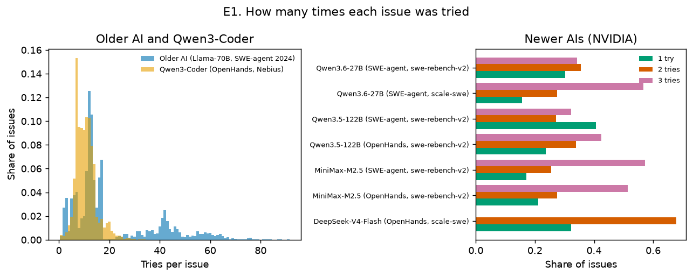
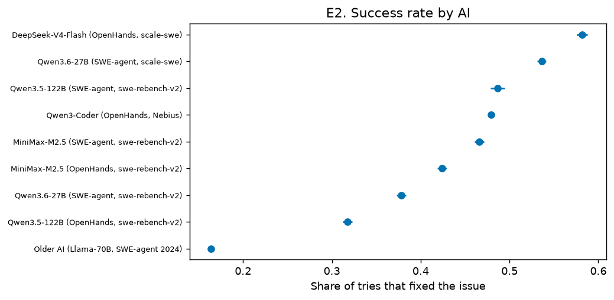
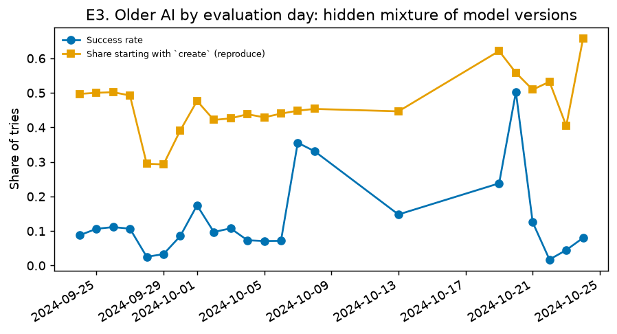
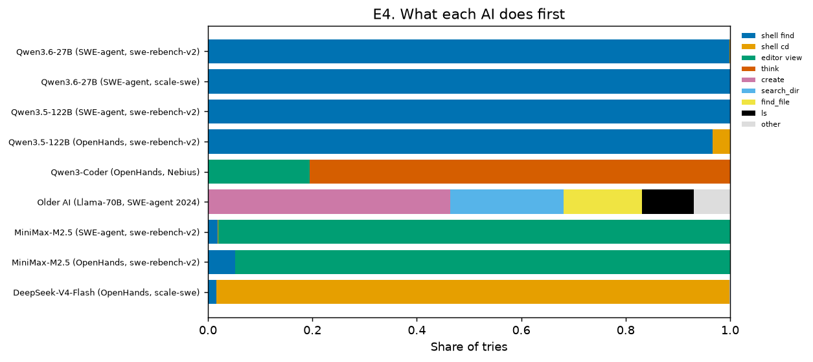
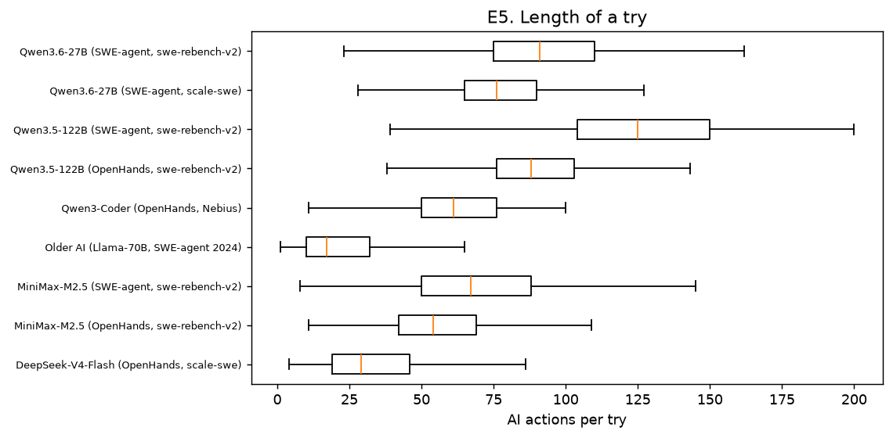
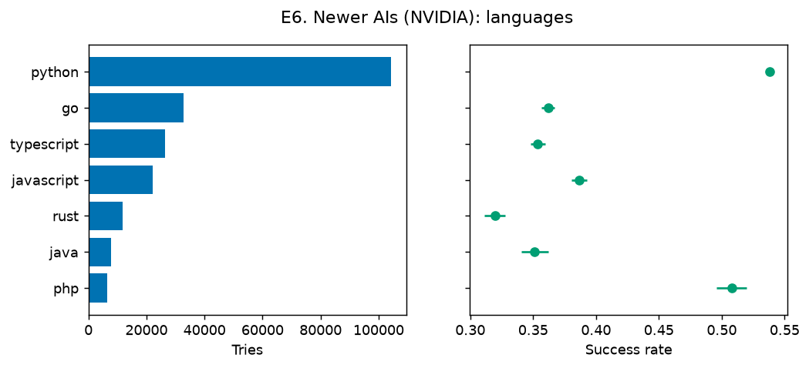
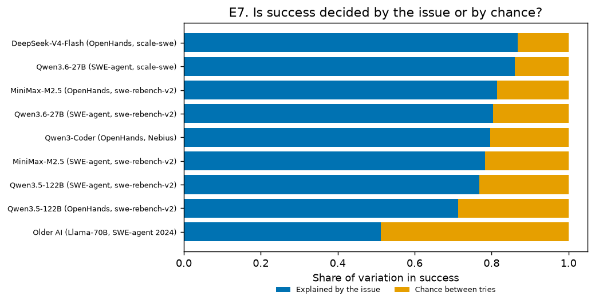

# Step 4: Exploratory Data Analysis

**Made with:** `agent-tips eda`. The charts are in `docs/figures/eda/`, and the numbers behind them are in `outputs/results/eda_stats.json`.
**Data used:** analysis-ready tries only. A try qualifies if it is in scope, saw the most common issue text, and has a known outcome: 353,009 tries across 9 AI configurations.

## In plain words

- **The older AI is the only one that is "undecided" at its very first move.** It starts in several different ways by chance, so it is the only AI where we can run a true coin-flip comparison on the first step. The newer AIs almost always start the same way.
- **The older AI's recordings mix several versions of the AI.** Day by day, its success rate jumps between 2% and 50%. This is why we only compare tries made on the same day.
- **NVIDIA's data has no tries that ran out of room**, because NVIDIA removed them. For the older AI, about 3 in 10 tries ran out of room. So NVIDIA's data can't show harm caused by running out of room.
- **For the newer AIs, success depends mostly on the bug, not on luck** (71–87%). For the older AI it's about half and half. Fair comparisons can only learn from bugs where some tries succeed and others fail, and that's 6–28% of bugs, depending on the AI.
- **Python bugs are fixed more often** (54%) than bugs in the other six languages (32–51%).

## E1. How many times each issue was tried

| AI (dataset) | Issues | Median tries per issue | 90th percentile | Max |
| --- | ---: | ---: | ---: | ---: |
| Older AI (Llama-70B) | 3,591 | 13 | 47 | 91 |
| Qwen3-Coder (Nebius) | 6,306 | 10 | 15 | 34 |
| NVIDIA subsets (7) | 7,885–16,515 each | 2–3 | 2–3 | 2–3 |

**What it means:** the older AI and Qwen3-Coder have many tries per bug, which suits fair same-bug comparisons. The NVIDIA AIs have only 1–3 tries per bug, and many bugs keep a single try once the unknown outcomes are removed. Those bugs can't contribute to a same-bug comparison. The large number of bugs makes up for this.

## E2. Success rate by AI

Success ranges from **16.4%** (older AI) to **58.2%** (DeepSeek-V4-Flash). The AIs worked on different task sets (SWE-bench-extra, SWE-rebench-V2 or scale-swe), so **these rates must not be compared across AIs**. Our analyses only ever compare tries within the same AI and the same bug.

## E3. Older AI: a hidden mixture of model versions

Over 22 evaluation days:
- the success rate ranges from **1.7% to 50.2%**;
- the share of tries that start by writing a reproduction script ranges from **29% to 66%**.

A single model would not swing like this. The dataset's "70B" label most likely covers several training checkpoints, which matches Nebius's description of collecting tries from "earlier versions" of their models. **This confirms the plan (P1) to compare tries only within the same issue and the same evaluation day.**

## E4. What each AI does first

| AI | First moves |
| --- | --- |
| Older AI | `create` (reproduction script) 46%, `search_dir` 22%, `find_file` 15%, `ls` 10%, `open` 2% |
| Qwen3-Coder | `think` 81%, `view` 19% |
| MiniMax-M2.5 | `view` 95–98% |
| Qwen3.5 / Qwen3.6 | `find` 97–100% |
| DeepSeek-V4-Flash | `cd` 98% |

**What it means:**
- The older AI is genuinely undecided at its first move, so its first-step comparison is a real coin flip (P1).
- Qwen3-Coder offers one clean first-step coin flip, `think` vs `view` (S12).
- The NVIDIA AIs almost always start the same way, so their "test first" choice can only be studied later in the try (P2).

## E5. Length of a try, and running out of room

| AI | Median actions per try | Tries that hit a limit |
| --- | ---: | ---: |
| Older AI | 17 | **29.4%** (context limit) |
| Qwen3-Coder | 61 | 9.0% (100-step limit) |
| NVIDIA AIs | 29–125 | **0%** (removed by NVIDIA) |

**What it means:**
- Running out of room is common for the older AI, and earlier results suggested it explains why reproducing first hurt (S10).
- In NVIDIA's data the share is exactly zero because those tries were filtered out before release. This confirms the survivorship limit that the plan already allows for (the tipping-point analysis in Step 7).

## E6. Newer AIs (NVIDIA): languages

| Language | Tries | Success |
| --- | ---: | ---: |
| Python | 104,313 | 53.8% |
| PHP | 6,594 | 50.8% |
| JavaScript | 22,273 | 38.7% |
| Go | 32,699 | 36.2% |
| TypeScript | 26,354 | 35.4% |
| Java | 7,741 | 35.1% |
| Rust | 11,796 | 32.0% |

Half of the NVIDIA tries are Python. The language analysis (S9) has enough tries in every language listed.

## E7. Is success decided by the issue or by chance?

| AI | Variation explained by the issue | Issues with mixed outcomes |
| --- | ---: | ---: |
| Older AI | 51% | 22% |
| Qwen3-Coder | 80% | 28% |
| NVIDIA AIs | 71–87% | 6–16% |

**What it means:**
- For the newer AIs, whether a try succeeds is mostly decided by which bug it is. Chance plays a bigger part for the older AI.
- Only bugs with **mixed outcomes**, where some tries succeed and some fail, carry information for a same-bug comparison. That is 6–28% of bugs. This explains why same-bug estimates use far fewer bugs than the totals, and it is accounted for in the confidence intervals.
- It also matches He et al. (2026): uncertainty in agent outcomes sits mostly at the task level.

The variation share is a one-way ANOVA intraclass correlation computed on the 0/1 outcome, using issues with at least 2 tries.

## What this means for the next steps

| Finding | Consequence |
| --- | --- |
| Hidden version mixture (E3) | Keep the issue × day strata for the older AI (P1); run batch sensitivity in Step 7 |
| Only the older AI hesitates at step 0 (E4) | P1 is the only exact first-step coin flip; the NVIDIA analyses rely on same-bug comparisons and exact forks |
| NVIDIA removed tries that hit limits (E5) | State the survivorship limit; run the tipping-point analysis in Step 7 |
| Few mixed-outcome bugs (E7) | Report how many strata contribute to each estimate; check positivity per comparison (design checks) |
| Language imbalance (E6) | Report language results per language (S9), not only pooled |

**Change from the plan:** the chart "how often each AI follows each tip" needs the action labels from Step 5. It moves to the feature report, and E4 here shows raw first actions instead.
