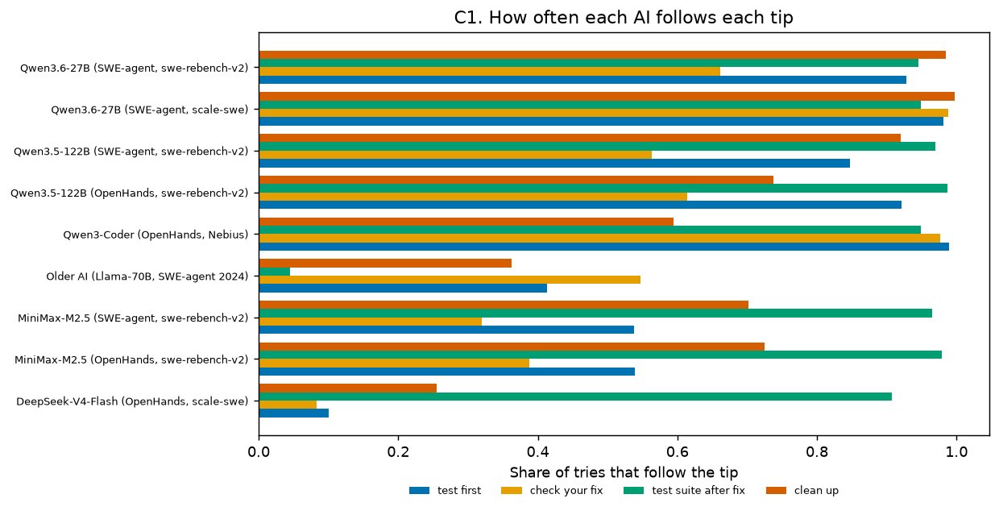

# Step 5: Features and Label Validation

*Generated by `agent-tips features`. Numbers come from `data/processed/` and `outputs/results/label_validation.json`.*

## In plain words

- **Every AI action now has a label**, such as "created a test script", "edited project code" or "ran the project's tests". One shared set of rules labels all three datasets, and 133 hand-written test cases check those rules.
- **The labels were checked twice, without human effort:**
  1. against what the computer replied, for example "file created";
  2. by a blind second labeling of a random sample, done by the AI assistant. The paper will report this as AI-assisted, not human, validation.
- **Bug found and fixed:** the earlier exploration code counted *every* new file inside NVIDIA's `/testbed` folder as a test script, because the folder name contains "test". Only the file name is checked now. Together with the other label fixes, the affected shares moved by up to about 3 points.
- **New fact:** about half of the older AI's attempts to edit code were **rejected by its editor** for breaking the code.
- **Each bug also has simple features:** whether the report includes example code, an error trace or a file name. Each bug also records which files the real fix changed ("gold files"), so we can see when the AI first touches them.

## Labels

| Label | Meaning | newer_ai_nebius | newer_ai_nvidia | older_ai |
| --- | --- | ---: | ---: | ---: |
| `repro_create` | created a test or reproduction script | 8.5% | 6.4% | 3.1% |
| `create_other` | created another new file | 0.1% | 1.3% | 0.6% |
| `edit_code` | edited existing project code | 5.3% | 6.8% | 17.1% |
| `edit_created` | edited a file the try itself created | 2.5% | 2.5% | 12.3% |
| `run` | ran a script or program | 18.9% | 17.0% | 12.9% |
| `test_suite` | ran the project's test suite | 10.1% | 11.8% | 0.5% |
| `look` | looked at or searched files | 46.4% | 49.4% | 42.6% |
| `think` | a 'think' call (no action) | 4.2% | 0.7% | 0.0% |
| `plan` | a planning call | 1.3% | 0.0% | 0.0% |
| `cleanup` | deleted files | 1.2% | 2.1% | 1.9% |
| `submit` | submitted / finished | 1.4% | 2.0% | 2.6% |
| `other` | anything else (installs, git, cd, ...) | 0.0% | 0.0% | 6.5% |

Shares are of all steps in each dataset.

## How often each AI follows each tip

| AI | Tries | first move: reproduce (R) | test first | check your fix | test suite after fix | clean up | never edits code |
| --- | ---: | ---: | ---: | ---: | ---: | ---: | ---: |
| Qwen3-Coder (OpenHands, Nebius) | 67,049 | — | 98.9% | 97.7% | 94.8% | 59.4% | 1.2% |
| Older AI (Llama-70B, SWE-agent 2024) | 73,738 | 46.4% | 41.3% | 54.8% | 4.5% | 36.3% | 17.6% |
| DeepSeek-V4-Flash (OpenHands, scale-swe) | 26,453 | — | 10.1% | 8.3% | 90.7% | 25.5% | 1.3% |
| MiniMax-M2.5 (OpenHands, swe-rebench-v2) | 33,873 | — | 53.9% | 38.7% | 97.9% | 72.5% | 2.9% |
| Qwen3.5-122B (OpenHands, swe-rebench-v2) | 30,957 | — | 92.2% | 61.4% | 98.7% | 73.7% | 2.9% |
| MiniMax-M2.5 (SWE-agent, swe-rebench-v2) | 35,955 | — | 53.8% | 32.0% | 96.5% | 70.1% | 3.9% |
| Qwen3.5-122B (SWE-agent, swe-rebench-v2) | 15,098 | — | 84.7% | 56.3% | 96.9% | 92.0% | 1.4% |
| Qwen3.6-27B (SWE-agent, scale-swe) | 36,206 | — | 98.1% | 98.8% | 94.9% | 99.7% | 1.4% |
| Qwen3.6-27B (SWE-agent, swe-rebench-v2) | 33,680 | — | 92.8% | 66.1% | 94.5% | 98.5% | 2.4% |

"Test first", "check your fix" and "test suite after fix" are shares of tries that edited project code. "First move" applies only to the older AI.

## Consistency with the exploration

| AI | Measure | Exploration | Now | Difference |
| --- | --- | ---: | ---: | ---: |
| Older AI (Llama-70B, SWE-agent 2024) | first move: reproduce (R) | 46.4% | 46.4% | +0.0 pts |
| Older AI (Llama-70B, SWE-agent 2024) | first move: search (S) | 47.9% | 47.9% | -0.0 pts |
| Older AI (Llama-70B, SWE-agent 2024) | check your fix | 53.9% | 54.8% | +0.9 pts |
| Older AI (Llama-70B, SWE-agent 2024) | test suite after fix | 4.2% | 4.5% | +0.3 pts |
| Qwen3-Coder (OpenHands, Nebius) | test first | 97.9% | 98.9% | +1.0 pts |
| DeepSeek-V4-Flash (OpenHands, scale-swe) | test first | 10.3% | 10.1% | -0.2 pts |
| MiniMax-M2.5 (OpenHands, swe-rebench-v2) | test first | 50.7% | 53.9% | +3.2 pts |
| Qwen3.5-122B (OpenHands, swe-rebench-v2) | test first | 89.8% | 92.2% | +2.4 pts |
| MiniMax-M2.5 (SWE-agent, swe-rebench-v2) | test first | 56.9% | 53.8% | -3.1 pts |
| Qwen3.5-122B (SWE-agent, swe-rebench-v2) | test first | 84.3% | 84.7% | +0.4 pts |
| Qwen3.6-27B (SWE-agent, scale-swe) | test first | 97.9% | 98.1% | +0.2 pts |
| Qwen3.6-27B (SWE-agent, swe-rebench-v2) | test first | 93.8% | 92.8% | -1.0 pts |

Differences of up to about 3 points have three causes:
1. the `/testbed` fix, which affects the SWE-agent subsets;
2. the broader scratch-script words added after validation round 1, which affect all subsets;
3. the denominators: the exploration counted all tries, while this table counts analysis-ready tries only.

## Label validation

### (a) Check against the computer's reply

| Dataset | Label | Steps | Confirmed by the reply | Edits rejected by the editor |
| --- | --- | ---: | ---: | ---: |
| newer_ai_nebius | `create_other` | 6,006 | 92.4% | — |
| newer_ai_nebius | `edit_code` | 230,815 | 99.6% | 5.4% |
| newer_ai_nebius | `edit_created` | 109,250 | 99.8% | 7.4% |
| newer_ai_nebius | `repro_create` | 368,033 | 99.7% | — |
| newer_ai_nebius | `test_suite` | 436,039 | 96.2% | — |
| newer_ai_nvidia | `create_other` | 256,474 | 97.0% | — |
| newer_ai_nvidia | `edit_code` | 1,384,871 | 98.1% | 1.5% |
| newer_ai_nvidia | `edit_created` | 511,194 | 97.2% | 1.7% |
| newer_ai_nvidia | `repro_create` | 1,292,642 | 96.8% | — |
| newer_ai_nvidia | `test_suite` | 2,389,613 | 90.7% | — |
| older_ai | `create_other` | 12,047 | 91.6% | — |
| older_ai | `edit_code` | 330,727 | 94.6% | 51.3% |
| older_ai | `edit_created` | 237,070 | 96.2% | 18.5% |
| older_ai | `repro_create` | 59,164 | 98.8% | — |
| older_ai | `test_suite` | 9,573 | 89.6% | — |

- "Confirmed" means the reply fits the label:
  - for creates: a "file created" message (editor), or no error message (shell);
  - for edits: an "edited" message *or* a "rejected" message. Either way, the agent did try to edit.
  - for test runs: test-framework output at the start or the end of the reply.
- Only the first and last 300 characters of each reply are kept, so these figures are lower bounds.

### (b) Blind second labeling

#### Round 1 (original rules; 645 steps, all labels)

Overall: **645 steps, agreement 90.5%, Cohen's κ = 0.896** (target ≥ 0.80).

| Dataset | Steps | Agreement | κ |
| --- | ---: | ---: | ---: |
| newer_ai_nebius | 240 | 92.9% | 0.923 |
| newer_ai_nvidia | 205 | 89.8% | 0.886 |
| older_ai | 200 | 88.5% | 0.872 |

| Rule label | Times in sample | Precision (second labeling agrees) | Recall |
| --- | ---: | ---: | ---: |
| `repro_create` | 60 | 98.3% | 68.6% |
| `create_other` | 60 | 50.0% | 96.8% |
| `edit_code` | 60 | 100.0% | 87.0% |
| `edit_created` | 60 | 88.3% | 100.0% |
| `run` | 60 | 100.0% | 89.5% |
| `test_suite` | 60 | 93.3% | 100.0% |
| `look` | 60 | 100.0% | 81.1% |
| `think` | 40 | 100.0% | 100.0% |
| `plan` | 20 | 100.0% | 100.0% |
| `cleanup` | 60 | 98.3% | 98.3% |
| `submit` | 60 | 100.0% | 100.0% |
| `other` | 45 | 60.0% | 93.1% |

#### Round 2 (rules after the round-1 fixes; fresh sample of 300 steps, 7 labels)

Overall: **300 steps, agreement 88.0%, Cohen's κ = 0.860** (target ≥ 0.80).

| Dataset | Steps | Agreement | κ |
| --- | ---: | ---: | ---: |
| newer_ai_nebius | 105 | 91.4% | 0.900 |
| newer_ai_nvidia | 90 | 88.9% | 0.867 |
| older_ai | 105 | 83.8% | 0.813 |

| Rule label | Times in sample | Precision (second labeling agrees) | Recall |
| --- | ---: | ---: | ---: |
| `repro_create` | 45 | 100.0% | 72.6% |
| `create_other` | 45 | 60.0% | 100.0% |
| `edit_code` | 45 | 97.8% | 86.3% |
| `edit_created` | 45 | 84.4% | 100.0% |
| `test_suite` | 45 | 100.0% | 100.0% |
| `look` | 45 | 97.8% | 93.6% |
| `other` | 30 | 70.0% | 95.5% |

**What changed between rounds.** Round 1 found three problems, and all were fixed before round 2:
1. Test-tool names inside paths (`tox-dev__tox`, `nirspec`) were read as test runs. Test-tool names now have to start a command word.
2. Scratch scripts with generic names were missed. Common scratch-script words were added, and documents (`.md`, `.txt`, `.rst`) never count as scripts.
3. Appends (`>>`) counted as new files, and the web `fetch` tool counted as "other". Appends are now edits and `fetch` is "look".

Round 2 used a **fresh** random sample, so the rules were not tuned to the steps that check them.

**Known remaining limits:**
- `repro_create` is conservative. It is almost never wrong when it fires (precision 100%), but it misses scratch scripts with generic names (recall 73%). As a result, "test first" is slightly undercounted, and Step 7 includes a sensitivity analysis with a broader definition (any new file).
- Most `edit_created` vs `edit_code` disagreements come from the second labeler not seeing the try's history. The rules check whether the try created the file itself, so they are likely right in those cases.
- Calls to other command-line tools (e.g. `dvc list`, `pyupgrade x.py`) are labelled `other` rather than `run`. This does not affect any hypothesis.

Both samples, with the rule label and the second label side by side, are in [`docs/data/label_validation/`](data/label_validation/sample.csv).

## Issue features

| Dataset | Issues | Has code block | Has stack trace | Names a file | Gold patch found | Median length (chars) |
| --- | ---: | ---: | ---: | ---: | ---: | ---: |
| newer_ai_nebius | 6,306 | 60.1% | 14.8% | 36.2% | 0.0% | 856 |
| newer_ai_nvidia | 117,664 | 52.0% | 5.0% | 53.3% | 100.0% | 1,940 |
| older_ai | 3,591 | 57.8% | 14.5% | 35.0% | 99.8% | 724 |

## Localization: when the AI first touches a gold file

| Dataset | Tries with a known gold patch | …that touch a gold file | Median step of first touch |
| --- | ---: | ---: | ---: |
| newer_ai_nebius | 0.0% | — | — |
| newer_ai_nvidia | 100.0% | 99.2% | 3 |
| older_ai | 99.8% | 77.1% | 4 |

A step "touches" a gold file if its path, the file open in the editor, or its command mentions a file changed by the real fix.
