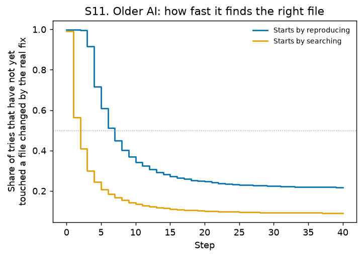

# Step 6: Results

*Generated by `agent-tips model` from `outputs/results/`. Analyses follow the frozen plan `docs/01_problem_and_hypotheses.md` (tag `analysis-plan-v1`).*

## In plain words

- **Reproducing first hurt the older AI:** -3.5 bugs fixed per 100 tries (95% CI -4.8 to -2.2). This is a true coin-flip comparison.
- **For the newer AIs, testing first made no meaningful difference:** +0.1 per 100 tries, and the 90% CI (-0.4 to +0.5) lies within the ±2-point margin set in advance.
- **Simple analyses are badly misleading:** across 57 tip × AI comparisons, simple and fair estimates differ by 10.9 points on average (95% CI 10.3 to 11.9). In 37% of comparisons they point in opposite directions.
- **Secondary questions:** 11 of 73 secondary estimates stay significant after correcting for testing many things at once (Benjamini–Hochberg, q < 0.05). See the tables below.
- **Why reproducing first hurt:** it uses up the older AI's memory and slows it down. These tries ran out of context more often, and reached the file the real fix changed later (median step 7 vs 2).
- **Design checks:**
  - placebo -0.8 pts [-2.3, +0.8] (should be about 0);
  - the hour does not predict the first move within a day (p = 0.44).

## Main results

| Hypothesis | Fair comparison (main) | Simple comparison | Fixed-effects regression | Decision |
| --- | --- | --- | --- | --- |
| **P1** reproduce first, older AI (issue × day; permutation p <0.001) | -3.5 pts [-4.8, -2.2] | -2.8 pts [-5.2, -0.4] | -3.5 pts [-4.9, -2.1] | harm |
| **P2** test first, newer AIs pooled (issue; permutation p 0.803) | +0.1 pts [-0.5, +0.6] (90% CI -0.4, +0.5) | +1.9 pts [+1.2, +2.5] | +0.1 pts [-0.6, +0.8] | equivalent within ±2 points |
| **P3** mean absolute gap between simple and fair | 10.9 pts [10.3, 11.9] over 57 pairs | — | — | supported (> 2 pts) |

Fair estimates use 1,870 issue × day groups (1,048 issues, 13,509 tries) for P1 and 9,776 issues (25,773 tries) for P2.

### P2 per AI

| AI | Fair (same issue) | Simple (pooled) | Issues used |
| --- | --- | --- | ---: |
| DeepSeek-V4-Flash (OpenHands, scale-swe) | -0.3 pts [-1.9, +1.3] | -3.1 pts [-5.5, -0.7] | 874 |
| MiniMax-M2.5 (OpenHands, swe-rebench-v2) | +0.2 pts [-0.8, +1.2] | +12.1 pts [+10.6, +13.5] | 2,765 |
| Qwen3.5-122B (OpenHands, swe-rebench-v2) | -1.0 pts [-3.2, +0.9] | +15.7 pts [+13.7, +17.7] | 909 |
| MiniMax-M2.5 (SWE-agent, swe-rebench-v2) | +0.3 pts [-0.6, +1.3] | +11.0 pts [+9.7, +12.5] | 3,382 |
| Qwen3.5-122B (SWE-agent, swe-rebench-v2) | +1.5 pts [-0.7, +3.8] | +22.1 pts [+19.7, +24.5] | 719 |
| Qwen3.6-27B (SWE-agent, scale-swe) | -0.4 pts [-3.3, +2.5] | +27.1 pts [+22.7, +31.6] | 330 |
| Qwen3.6-27B (SWE-agent, swe-rebench-v2) | -0.9 pts [-2.6, +1.0] | +22.7 pts [+20.7, +24.6] | 797 |

### Near coin flips (exact forks, newer AIs)

| Comparison | Estimate | Fork pairs | Issues |
| --- | --- | ---: | ---: |
| Test file now vs anything else now (exact forks) | -0.0 pts [-1.0, +1.0] | 3,563 | 2,504 |
| Test file now vs edit code now (exact forks) | +0.0 pts [+0.0, +0.0] | 7 | 5 |

Total fork pairs (tries of the same issue with identical histories up to their first difference): 152,058.

## P3: the simple-analysis trap

- **Mean absolute gap:** 10.9 points [10.3, 11.9].
- **Sign differs:** 37% of pairs.
- **Significance differs:** 77% of pairs.
- **Without the 7 underpowered pairs** (fewer than 100 groups, which the plan says not to interpret): mean gap 9.7 points [9.2, 10.3] over 50 pairs; sign differs in 38%, significance in 80%.
- An estimate of exactly 0 has no direction, so it never counts as an opposite sign.
- **Simpson's paradox:** pooled across the newer AIs, the simple estimate for test first is +1.9 points. Within each AI it ranges from -3.1 to +27.1.

| Comparison | AI | Simple | Fair | Gap |
| --- | --- | ---: | ---: | ---: |
| S3 Ran any code after fixing | Qwen3.5-122B (OpenHands, swe-rebench-v2) | +32.4 | +0.0 | +32.4 |
| P2-sub Test first, per AI | Qwen3.6-27B (SWE-agent, scale-swe) | +27.1 | -0.4 | +27.5 |
| S3 Ran any code after fixing | Qwen3.6-27B (SWE-agent, scale-swe) | +32.5 | +5.6 | +26.9 |
| S2 Ran the project's test suite after fixing | Qwen3.6-27B (SWE-agent, scale-swe) | +25.2 | -0.2 | +25.4 |
| S3 Ran any code after fixing | Qwen3.5-122B (SWE-agent, swe-rebench-v2) | +23.8 | +0.0 | +23.8 |
| P2-sub Test first, per AI | Qwen3.6-27B (SWE-agent, swe-rebench-v2) | +22.7 | -0.9 | +23.6 |
| S4 Wrote extra tests after fixing | Qwen3.5-122B (OpenHands, swe-rebench-v2) | +23.8 | +3.2 | +20.6 |
| P2-sub Test first, per AI | Qwen3.5-122B (SWE-agent, swe-rebench-v2) | +22.1 | +1.5 | +20.6 |
| S3 Ran any code after fixing | MiniMax-M2.5 (OpenHands, swe-rebench-v2) | +18.4 | +1.1 | +17.2 |
| P2-sub Test first, per AI | Qwen3.5-122B (OpenHands, swe-rebench-v2) | +15.7 | -1.0 | +16.7 |
| S5 Cleaned up created files | Qwen3.6-27B (SWE-agent, scale-swe) | +10.2 | -6.3 | +16.5 |
| S4 Wrote extra tests after fixing | Qwen3.6-27B (SWE-agent, scale-swe) | +12.4 | -3.7 | +16.1 |
| S5 Cleaned up created files | Qwen3.5-122B (SWE-agent, swe-rebench-v2) | +16.5 | +1.1 | +15.4 |
| S2 Ran the project's test suite after fixing | Qwen3.5-122B (SWE-agent, swe-rebench-v2) | +13.8 | -1.2 | +14.9 |
| S4 Wrote extra tests after fixing | DeepSeek-V4-Flash (OpenHands, scale-swe) | -14.9 | +0.0 | -14.9 |
| S6 Ran the project's test suite before fixing | DeepSeek-V4-Flash (OpenHands, scale-swe) | -13.9 | +0.7 | -14.6 |
| S3 Ran any code after fixing | DeepSeek-V4-Flash (OpenHands, scale-swe) | +13.0 | -0.8 | +13.8 |
| S2 Ran the project's test suite after fixing | Qwen3.6-27B (SWE-agent, swe-rebench-v2) | +14.6 | +0.8 | +13.7 |
| S1 Check your fix (re-ran own test script after fixing) | Qwen3.6-27B (SWE-agent, swe-rebench-v2) | +13.7 | +0.1 | +13.6 |
| S2 Ran the project's test suite after fixing | MiniMax-M2.5 (OpenHands, swe-rebench-v2) | +13.3 | -0.2 | +13.5 |
| S6 Ran the project's test suite before fixing | Qwen3.5-122B (OpenHands, swe-rebench-v2) | -16.1 | -3.6 | -12.5 |
| S3 Ran any code after fixing | MiniMax-M2.5 (SWE-agent, swe-rebench-v2) | +11.2 | -0.7 | +11.9 |
| P2-sub Test first, per AI | MiniMax-M2.5 (OpenHands, swe-rebench-v2) | +12.1 | +0.2 | +11.9 |
| S5 Cleaned up created files | DeepSeek-V4-Flash (OpenHands, scale-swe) | -11.3 | +0.3 | -11.6 |
| P2-sub Test first, per AI | MiniMax-M2.5 (SWE-agent, swe-rebench-v2) | +11.0 | +0.3 | +10.7 |
| S4 Wrote extra tests after fixing | Qwen3.6-27B (SWE-agent, swe-rebench-v2) | +7.8 | -2.9 | +10.7 |
| S3 Ran any code after fixing | Qwen3.6-27B (SWE-agent, swe-rebench-v2) | +18.9 | +8.3 | +10.6 |
| S5 Cleaned up created files | MiniMax-M2.5 (OpenHands, swe-rebench-v2) | +10.7 | +0.2 | +10.5 |
| S5 Cleaned up created files | Qwen3.6-27B (SWE-agent, swe-rebench-v2) | +11.2 | +1.0 | +10.2 |
| S6 Ran the project's test suite before fixing | Qwen3.6-27B (SWE-agent, scale-swe) | -9.5 | +0.4 | -9.8 |
| S1 Check your fix (re-ran own test script after fixing) | MiniMax-M2.5 (SWE-agent, swe-rebench-v2) | +10.1 | +0.4 | +9.7 |
| S6 Ran the project's test suite before fixing | MiniMax-M2.5 (SWE-agent, swe-rebench-v2) | -9.8 | -0.4 | -9.4 |
| S1 Check your fix (re-ran own test script after fixing) | Qwen3.5-122B (SWE-agent, swe-rebench-v2) | +8.1 | -1.2 | +9.3 |
| S5 Cleaned up created files | MiniMax-M2.5 (SWE-agent, swe-rebench-v2) | +8.7 | +0.2 | +8.5 |
| S1 Check your fix (re-ran own test script after fixing) | Qwen3.6-27B (SWE-agent, scale-swe) | +10.2 | +1.7 | +8.4 |
| S6 Ran the project's test suite before fixing | MiniMax-M2.5 (OpenHands, swe-rebench-v2) | -8.7 | -0.6 | -8.1 |
| S13 First move find_file vs search_dir | Older AI (Llama-70B, SWE-agent 2024) | +7.5 | -0.5 | +8.0 |
| S2 Ran the project's test suite after fixing | DeepSeek-V4-Flash (OpenHands, scale-swe) | +7.6 | -0.2 | +7.8 |
| S1 Check your fix (re-ran own test script after fixing) | Older AI (Llama-70B, SWE-agent 2024) | +9.9 | +2.7 | +7.2 |
| S6 Ran the project's test suite before fixing | Qwen3.6-27B (SWE-agent, swe-rebench-v2) | -6.8 | +0.2 | -7.0 |
| S1 Check your fix (re-ran own test script after fixing) | MiniMax-M2.5 (OpenHands, swe-rebench-v2) | +6.7 | +0.4 | +6.3 |
| S2 Ran the project's test suite after fixing | Qwen3.5-122B (OpenHands, swe-rebench-v2) | +7.8 | +2.2 | +5.5 |
| S1 Check your fix (re-ran own test script after fixing) | Qwen3.5-122B (OpenHands, swe-rebench-v2) | +9.3 | +4.1 | +5.1 |
| S13 First move open vs search_dir | Older AI (Llama-70B, SWE-agent 2024) | +10.0 | +5.0 | +5.1 |
| S12 First move think vs view (Qwen3-Coder) | Qwen3-Coder (OpenHands, Nebius) | +3.5 | -0.1 | +3.6 |
| S1 Check your fix (re-ran own test script after fixing) | DeepSeek-V4-Flash (OpenHands, scale-swe) | -4.3 | -0.7 | -3.6 |
| S2 Ran the project's test suite after fixing | MiniMax-M2.5 (SWE-agent, swe-rebench-v2) | +5.0 | +1.7 | +3.3 |
| P2-sub Test first, per AI | DeepSeek-V4-Flash (OpenHands, scale-swe) | -3.1 | -0.3 | -2.7 |
| S4 Wrote extra tests after fixing | Qwen3.5-122B (SWE-agent, swe-rebench-v2) | +1.0 | -1.3 | +2.4 |
| S4 Wrote extra tests after fixing | MiniMax-M2.5 (SWE-agent, swe-rebench-v2) | +2.9 | +0.6 | +2.3 |
| S13 First move grep vs search_dir | Older AI (Llama-70B, SWE-agent 2024) | -3.3 | -1.2 | -2.0 |
| S4 Wrote extra tests after fixing | MiniMax-M2.5 (OpenHands, swe-rebench-v2) | -1.5 | +0.1 | -1.6 |
| S6 Ran the project's test suite before fixing | Qwen3.5-122B (SWE-agent, swe-rebench-v2) | +1.1 | +0.2 | +0.9 |
| S5 Cleaned up created files | Qwen3.5-122B (OpenHands, swe-rebench-v2) | +2.7 | +1.8 | +0.9 |
| P1 Reproduce first (older AI, first step) | Older AI (Llama-70B, SWE-agent 2024) | -2.8 | -3.5 | +0.7 |
| S13 First move ls vs search_dir | Older AI (Llama-70B, SWE-agent 2024) | -1.0 | -1.2 | +0.2 |
| S2 Ran the project's test suite after fixing | Older AI (Llama-70B, SWE-agent 2024) | -0.4 | -0.4 | +0.0 |

## Secondary hypotheses (Benjamini–Hochberg q-values)

| ID | Comparison | AI | Fair estimate | p | q | Issues |
| --- | --- | --- | --- | ---: | ---: | ---: |
| S1 | Check your fix (re-ran own test script after fixing) | Older AI (Llama-70B, SWE-agent 2024) | +2.7 pts [+1.9, +3.6] | <0.001 | 0.007 | 2,346 |
| S1 | Check your fix (re-ran own test script after fixing) | DeepSeek-V4-Flash (OpenHands, scale-swe) | -0.7 pts [-2.2, +0.8] | 0.403 | 0.797 | 1,011 |
| S1 | Check your fix (re-ran own test script after fixing) | MiniMax-M2.5 (OpenHands, swe-rebench-v2) | +0.4 pts [-0.5, +1.4] | 0.390 | 0.797 | 2,710 |
| S1 | Check your fix (re-ran own test script after fixing) | Qwen3.5-122B (OpenHands, swe-rebench-v2) | +4.1 pts [+2.4, +5.9] | <0.001 | 0.007 | 1,508 |
| S1 | Check your fix (re-ran own test script after fixing) | MiniMax-M2.5 (SWE-agent, swe-rebench-v2) | +0.4 pts [-0.6, +1.4] | 0.418 | 0.797 | 3,264 |
| S1 | Check your fix (re-ran own test script after fixing) | Qwen3.5-122B (SWE-agent, swe-rebench-v2) | -1.2 pts [-3.0, +0.6] | 0.193 | 0.695 | 1,145 |
| S1 | Check your fix (re-ran own test script after fixing) | Qwen3.6-27B (SWE-agent, scale-swe) | +1.7 pts [-1.8, +5.3] | 0.351 | 0.797 | 231 |
| S1 | Check your fix (re-ran own test script after fixing) | Qwen3.6-27B (SWE-agent, swe-rebench-v2) | +0.1 pts [-1.5, +1.7] | 0.949 | 1.000 | 1,503 |
| S10 | Submitted because the context ran out | Older AI (Llama-70B, SWE-agent 2024) | +11.0 pts [+9.2, +12.8] | <0.001 | 0.007 | 1,048 |
| S10 | Any context-limit exit | Older AI (Llama-70B, SWE-agent 2024) | +11.0 pts [+9.1, +12.8] | <0.001 | 0.007 | 1,048 |
| S11 | Finding the right file: per-step hazard | Older AI (Llama-70B, SWE-agent 2024) | -12.2 pts [-13.8, -10.7] | <0.001 | <0.001 |  |
| S12 | First move think vs view (Qwen3-Coder) | Qwen3-Coder (OpenHands, Nebius) | -0.1 pts [-0.7, +0.6] | 0.891 | 1.000 | 2,067 |
| S13 | First move find_file vs search_dir | Older AI (Llama-70B, SWE-agent 2024) | -0.5 pts [-2.0, +1.0] | 0.493 | 0.801 | 905 |
| S13 | First move ls vs search_dir | Older AI (Llama-70B, SWE-agent 2024) | -1.2 pts [-2.5, +0.1] | 0.063 | 0.354 | 963 |
| S13 | First move open vs search_dir | Older AI (Llama-70B, SWE-agent 2024) | +5.0 pts [-1.1, +11.3] | 0.130 | 0.593 | 111 |
| S13 | First move grep vs search_dir | Older AI (Llama-70B, SWE-agent 2024) | -1.2 pts [-4.0, +1.4] | 0.371 | 0.797 | 307 |
| S2 | Ran the project's test suite after fixing | Older AI (Llama-70B, SWE-agent 2024) | -0.4 pts [-2.1, +1.1] | 0.548 | 0.847 | 937 |
| S2 | Ran the project's test suite after fixing | DeepSeek-V4-Flash (OpenHands, scale-swe) | -0.2 pts [-2.4, +2.0] | 0.957 | 1.000 | 507 |
| S2 | Ran the project's test suite after fixing | MiniMax-M2.5 (OpenHands, swe-rebench-v2) | -0.2 pts [-3.8, +3.4] | 0.895 | 1.000 | 230 |
| S2 | Ran the project's test suite after fixing | Qwen3.5-122B (OpenHands, swe-rebench-v2) | +2.2 pts [-2.4, +7.3] | 0.367 | 0.797 | 174 |
| S2 | Ran the project's test suite after fixing | MiniMax-M2.5 (SWE-agent, swe-rebench-v2) | +1.7 pts [-0.9, +4.6] | 0.194 | 0.695 | 474 |
| S2 | Ran the project's test suite after fixing | Qwen3.5-122B (SWE-agent, swe-rebench-v2) | -1.2 pts [-6.8, +4.3] | 0.710 | 0.977 | 171 |
| S2 | Ran the project's test suite after fixing | Qwen3.6-27B (SWE-agent, scale-swe) | -0.2 pts [-3.9, +3.3] | 0.895 | 1.000 | 235 |
| S2 | Ran the project's test suite after fixing | Qwen3.6-27B (SWE-agent, swe-rebench-v2) | +0.8 pts [-1.4, +3.1] | 0.438 | 0.797 | 631 |
| S3 | Ran any code after fixing | DeepSeek-V4-Flash (OpenHands, scale-swe) | -0.8 pts [-6.2, +4.7] | 0.864 | 1.000 | 129 |
| S3 | Ran any code after fixing | MiniMax-M2.5 (OpenHands, swe-rebench-v2) | +1.1 pts [-11.2, +13.8] | 0.913 | 1.000 | 24 |
| S3 | Ran any code after fixing | Qwen3.5-122B (OpenHands, swe-rebench-v2) | +0.0 pts [+0.0, +0.0] | 1.000 | 1.000 | 8 |
| S3 | Ran any code after fixing | MiniMax-M2.5 (SWE-agent, swe-rebench-v2) | -0.7 pts [-5.7, +5.2] | 0.850 | 1.000 | 38 |
| S3 | Ran any code after fixing | Qwen3.5-122B (SWE-agent, swe-rebench-v2) | +0.0 pts [+0.0, +0.0] | 1.000 | 1.000 | 12 |
| S3 | Ran any code after fixing | Qwen3.6-27B (SWE-agent, scale-swe) | +5.6 pts [-5.6, +19.4] | 0.541 | 0.847 | 19 |
| S3 | Ran any code after fixing | Qwen3.6-27B (SWE-agent, swe-rebench-v2) | +8.3 pts [-3.4, +23.4] | 0.245 | 0.745 | 27 |
| S4 | Wrote extra tests after fixing | DeepSeek-V4-Flash (OpenHands, scale-swe) | +0.0 pts [-1.2, +1.1] | 1.000 | 1.000 | 2,279 |
| S4 | Wrote extra tests after fixing | MiniMax-M2.5 (OpenHands, swe-rebench-v2) | +0.1 pts [-0.7, +0.9] | 0.781 | 1.000 | 4,999 |
| S4 | Wrote extra tests after fixing | Qwen3.5-122B (OpenHands, swe-rebench-v2) | +3.2 pts [-1.6, +7.8] | 0.189 | 0.695 | 156 |
| S4 | Wrote extra tests after fixing | MiniMax-M2.5 (SWE-agent, swe-rebench-v2) | +0.6 pts [-0.2, +1.4] | 0.126 | 0.593 | 5,514 |
| S4 | Wrote extra tests after fixing | Qwen3.5-122B (SWE-agent, swe-rebench-v2) | -1.3 pts [-3.7, +1.2] | 0.346 | 0.797 | 572 |
| S4 | Wrote extra tests after fixing | Qwen3.6-27B (SWE-agent, scale-swe) | -3.7 pts [-9.4, +1.6] | 0.200 | 0.695 | 105 |
| S4 | Wrote extra tests after fixing | Qwen3.6-27B (SWE-agent, swe-rebench-v2) | -2.9 pts [-8.8, +2.4] | 0.316 | 0.797 | 130 |
| S5 | Cleaned up created files | DeepSeek-V4-Flash (OpenHands, scale-swe) | +0.3 pts [-0.7, +1.3] | 0.657 | 0.940 | 2,324 |
| S5 | Cleaned up created files | MiniMax-M2.5 (OpenHands, swe-rebench-v2) | +0.2 pts [-0.7, +1.2] | 0.575 | 0.856 | 3,281 |
| S5 | Cleaned up created files | Qwen3.5-122B (OpenHands, swe-rebench-v2) | +1.8 pts [+0.9, +2.8] | <0.001 | 0.007 | 4,032 |
| S5 | Cleaned up created files | MiniMax-M2.5 (SWE-agent, swe-rebench-v2) | +0.2 pts [-0.6, +1.1] | 0.625 | 0.912 | 3,899 |
| S5 | Cleaned up created files | Qwen3.5-122B (SWE-agent, swe-rebench-v2) | +1.1 pts [-1.6, +3.9] | 0.448 | 0.797 | 634 |
| S5 | Cleaned up created files | Qwen3.6-27B (SWE-agent, scale-swe) | -6.3 pts [-12.4, -0.9] | 0.020 | 0.122 | 85 |
| S5 | Cleaned up created files | Qwen3.6-27B (SWE-agent, swe-rebench-v2) | +1.0 pts [-1.5, +3.5] | 0.494 | 0.801 | 322 |
| S6 | Ran the project's test suite before fixing | DeepSeek-V4-Flash (OpenHands, scale-swe) | +0.7 pts [-0.4, +1.9] | 0.275 | 0.797 | 1,854 |
| S6 | Ran the project's test suite before fixing | MiniMax-M2.5 (OpenHands, swe-rebench-v2) | -0.6 pts [-1.6, +0.3] | 0.217 | 0.720 | 3,353 |
| S6 | Ran the project's test suite before fixing | Qwen3.5-122B (OpenHands, swe-rebench-v2) | -3.6 pts [-4.8, -2.3] | <0.001 | 0.007 | 2,807 |
| S6 | Ran the project's test suite before fixing | MiniMax-M2.5 (SWE-agent, swe-rebench-v2) | -0.4 pts [-1.4, +0.6] | 0.427 | 0.797 | 3,440 |
| S6 | Ran the project's test suite before fixing | Qwen3.5-122B (SWE-agent, swe-rebench-v2) | +0.2 pts [-1.5, +1.8] | 0.782 | 1.000 | 1,486 |
| S6 | Ran the project's test suite before fixing | Qwen3.6-27B (SWE-agent, scale-swe) | +0.4 pts [-0.4, +1.1] | 0.365 | 0.797 | 3,367 |
| S6 | Ran the project's test suite before fixing | Qwen3.6-27B (SWE-agent, swe-rebench-v2) | +0.2 pts [-0.8, +1.3] | 0.740 | 1.000 | 2,888 |
| S7 | Cost: steps | NVIDIA pooled | +1.9 [+1.4, +2.3] | <0.001 | 0.007 | 9,776 |
| S7 | Cost: characters read (thousands) | NVIDIA pooled | +3.4 [+2.4, +4.4] | <0.001 | 0.007 | 9,776 |
| S7 | Cost: characters written (thousands) | NVIDIA pooled | +1.5 [+0.9, +2.0] | <0.001 | 0.007 | 9,776 |
| S7 | Cost: steps | Older AI (Llama-70B, SWE-agent 2024) | +10.0 [+8.8, +11.3] | <0.001 | 0.007 | 1,048 |
| S8 | Reproduce first x issue type — arm x has_code_block | Older AI (Llama-70B, SWE-agent 2024) | +2.6 pts [-1.0, +6.2] | 0.158 | 0.680 |  |
| S8 | Reproduce first x issue type — arm x has_stack_trace | Older AI (Llama-70B, SWE-agent 2024) | -1.9 pts [-6.3, +2.5] | 0.406 | 0.797 |  |
| S8 | Reproduce first x issue type — arm x names_file | Older AI (Llama-70B, SWE-agent 2024) | -0.8 pts [-4.5, +2.9] | 0.679 | 0.953 |  |
| S8 | Reproduce first x issue type — arm x long_issue | Older AI (Llama-70B, SWE-agent 2024) | +0.2 pts [-3.8, +4.1] | 0.926 | 1.000 |  |
| S9 | Test first, language = go | NVIDIA pooled | +0.1 pts [-1.3, +1.6] | 0.879 | 1.000 | 1,730 |
| S9 | Test first, language = java | NVIDIA pooled | +1.5 pts [-1.4, +4.5] | 0.319 | 0.797 | 403 |
| S9 | Test first, language = javascript | NVIDIA pooled | +0.5 pts [-1.0, +2.1] | 0.492 | 0.801 | 1,171 |
| S9 | Test first, language = php | NVIDIA pooled | +2.5 pts [-0.8, +5.6] | 0.127 | 0.593 | 347 |
| S9 | Test first, language = python | NVIDIA pooled | -0.1 pts [-0.9, +0.7] | 0.822 | 1.000 | 3,851 |
| S9 | Test first, language = rust | NVIDIA pooled | -1.1 pts [-3.1, +0.8] | 0.287 | 0.797 | 750 |
| S9 | Test first, language = typescript | NVIDIA pooled | -0.1 pts [-1.6, +1.6] | 0.959 | 1.000 | 1,486 |
| S9 | Test first x language (vs python) — arm x lang_go | NVIDIA pooled | +0.2 pts [-1.9, +2.3] | 0.822 | 1.000 |  |
| S9 | Test first x language (vs python) — arm x lang_java | NVIDIA pooled | +1.6 pts [-2.3, +5.5] | 0.412 | 0.797 |  |
| S9 | Test first x language (vs python) — arm x lang_javascript | NVIDIA pooled | +0.7 pts [-1.5, +2.9] | 0.557 | 0.847 |  |
| S9 | Test first x language (vs python) — arm x lang_php | NVIDIA pooled | +2.6 pts [-1.6, +6.8] | 0.230 | 0.731 |  |
| S9 | Test first x language (vs python) — arm x lang_rust | NVIDIA pooled | -1.0 pts [-3.8, +1.8] | 0.477 | 0.801 |  |
| S9 | Test first x language (vs python) — arm x lang_typescript | NVIDIA pooled | +0.0 pts [-2.2, +2.3] | 0.973 | 1.000 |  |

- Steps and characters are counts or thousands, not points.
- Interaction rows (S8, S9) show how the effect changes for issues with the feature (S8) or for each language relative to Python (S9).
- Mid-run comparisons (S1–S6) are same-issue associations, not coin flips.

## Why reproducing first hurt the older AI (RQ6)

- **Median step at which a file changed by the real fix is first touched:** 7 when starting by reproducing (29,799 tries), vs 2 when starting by searching (30,081 tries).
- **Per-step chance of finding it** (fixed effects for issue × day × step): -12.2 pts [-13.8, -10.7].

## Design checks (RQ1)

- **Hour balance (older AI):** within issue × day, the evaluation hour does not predict the first move. Variation is 1.00× the chance level (p = 0.44; 1,736 groups).
- **Placebo** (`reproduce.py` vs `reproduce_bug.py`, which should show nothing): -0.8 pts [-2.3, +0.8].
- **Undecided agents** (tip followed by 5–95% of tries, so a fair comparison is possible): Qwen3-Coder (OpenHands, Nebius) no (99%), Older AI (Llama-70B, SWE-agent 2024) yes (41%), DeepSeek-V4-Flash (OpenHands, scale-swe) yes (10%), MiniMax-M2.5 (OpenHands, swe-rebench-v2) yes (54%), Qwen3.5-122B (OpenHands, swe-rebench-v2) yes (92%), MiniMax-M2.5 (SWE-agent, swe-rebench-v2) yes (54%), Qwen3.5-122B (SWE-agent, swe-rebench-v2) yes (85%), Qwen3.6-27B (SWE-agent, scale-swe) no (98%), Qwen3.6-27B (SWE-agent, swe-rebench-v2) yes (93%).
- **Positivity:** 7 of 71 fair comparisons have fewer than 100 informative groups and are labelled underpowered:
  - S3 Ran any code after fixing (MiniMax-M2.5 (OpenHands, swe-rebench-v2), 24 groups)
  - S3 Ran any code after fixing (Qwen3.5-122B (OpenHands, swe-rebench-v2), 8 groups)
  - S3 Ran any code after fixing (MiniMax-M2.5 (SWE-agent, swe-rebench-v2), 38 groups)
  - S3 Ran any code after fixing (Qwen3.5-122B (SWE-agent, swe-rebench-v2), 12 groups)
  - S3 Ran any code after fixing (Qwen3.6-27B (SWE-agent, scale-swe), 19 groups)
  - S3 Ran any code after fixing (Qwen3.6-27B (SWE-agent, swe-rebench-v2), 27 groups)
  - S5 Cleaned up created files (Qwen3.6-27B (SWE-agent, scale-swe), 85 groups)

## Final vs. exploratory numbers (task D4)

| Comparison | AI | Exploration | Final | Difference |
| --- | --- | ---: | ---: | ---: |
| P1 Reproduce first (older AI, first step) | Older AI (Llama-70B, SWE-agent 2024) | -3.5 | -3.5 | +0.0 |
| P2 Test first (newer AIs, pooled) | NVIDIA pooled | +0.3 | +0.1 | -0.2 |
| S1 Check your fix (re-ran own test script after fixing) | Older AI (Llama-70B, SWE-agent 2024) | +3.0 | +2.7 | -0.3 |
| S2 Ran the project's test suite after fixing | Older AI (Llama-70B, SWE-agent 2024) | +0.3 | -0.4 | -0.7 |
| S7 Cost: steps | Older AI (Llama-70B, SWE-agent 2024) | +10.0 | +10.0 | -0.0 |
| S7 Cost: steps | NVIDIA pooled | +1.8 | +1.9 | +0.1 |
| S10 Submitted because the context ran out | Older AI (Llama-70B, SWE-agent 2024) | +11.0 | +11.0 | -0.0 |
| S12 First move think vs view (Qwen3-Coder) | Qwen3-Coder (OpenHands, Nebius) | -0.1 | -0.1 | -0.0 |
| S13 First move find_file vs search_dir | Older AI (Llama-70B, SWE-agent 2024) | -0.5 | -0.5 | -0.0 |
| S13 First move ls vs search_dir | Older AI (Llama-70B, SWE-agent 2024) | -1.2 | -1.2 | -0.0 |
| S13 First move open vs search_dir | Older AI (Llama-70B, SWE-agent 2024) | +5.0 | +5.0 | -0.0 |
| S13 First move grep vs search_dir | Older AI (Llama-70B, SWE-agent 2024) | -1.2 | -1.2 | -0.0 |

Differences larger than 0.5 come from three changes since the exploration:
1. the fixed labeler: the `/testbed` and test-tool fixes, and broader scratch-script words;
2. analysis-ready tries only: known outcome and same issue text;
3. "check your fix", which is now defined from the labeler (re-running the try's own test or reproduction script after the first code edit), not from file names in the editor.
