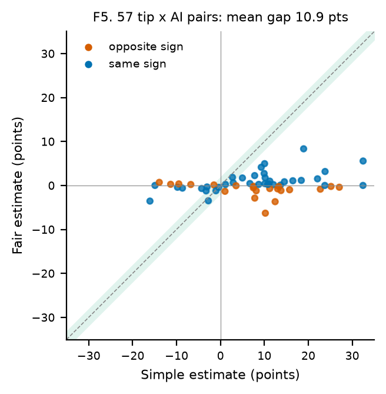

# Do Tips for AI Coding Agents Help?

We test, with data, whether popular tips given to AI coding assistants actually help them fix more bugs. We also show that the usual way of analyzing AI recordings gives wrong answers.

- **Plan and procedure:** [Project plan](project/PROJECT_PLAN.md)
- **Results so far:** [Proposal and results](project/DS_PROJECT_PROPOSAL.md)
- **Code reference:** [API reference](reference.md)

Step reports 01–08 are in the navigation. The paper draft is `paper/main.pdf` in the repository.

## Main findings

- **Reproducing the bug first hurt an older AI**: 3.5 fewer bugs fixed per 100 tries, in a fair coin-flip comparison.
- **For four newer AIs (seven setups), testing first made no meaningful difference.**
- **Simple analyses mislead**: they differ from fair ones by about 11 points on average, often in the opposite direction.

