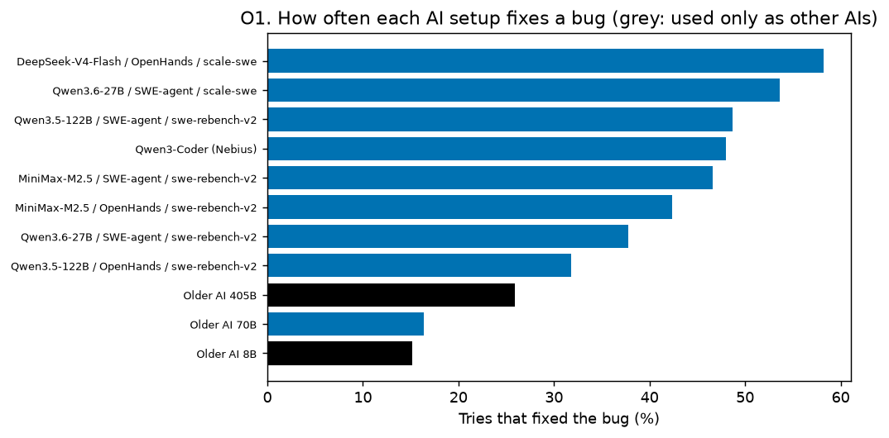
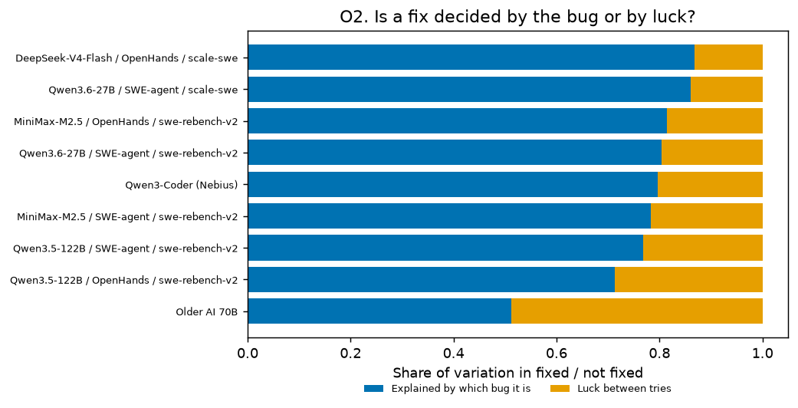
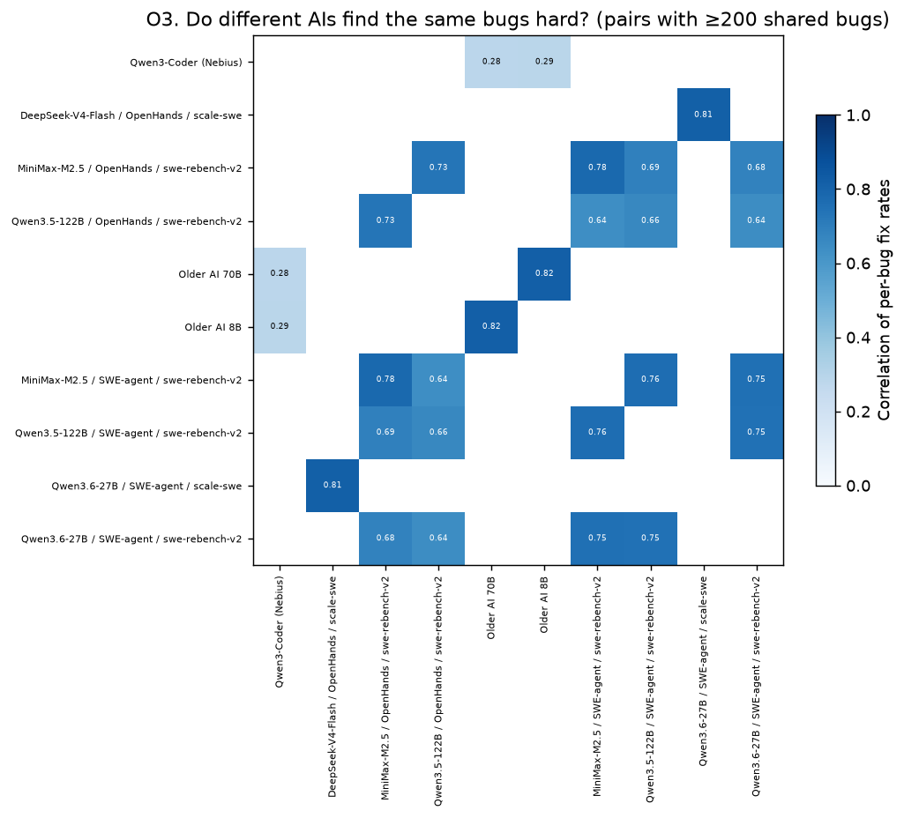
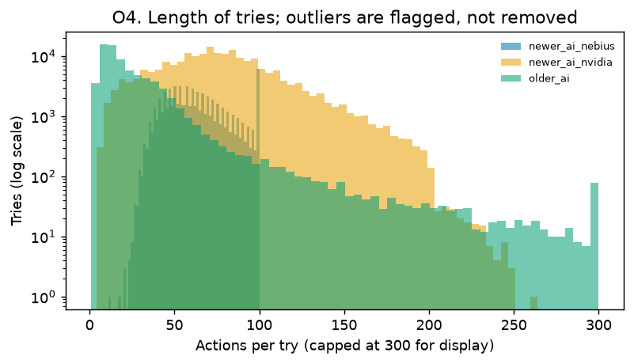
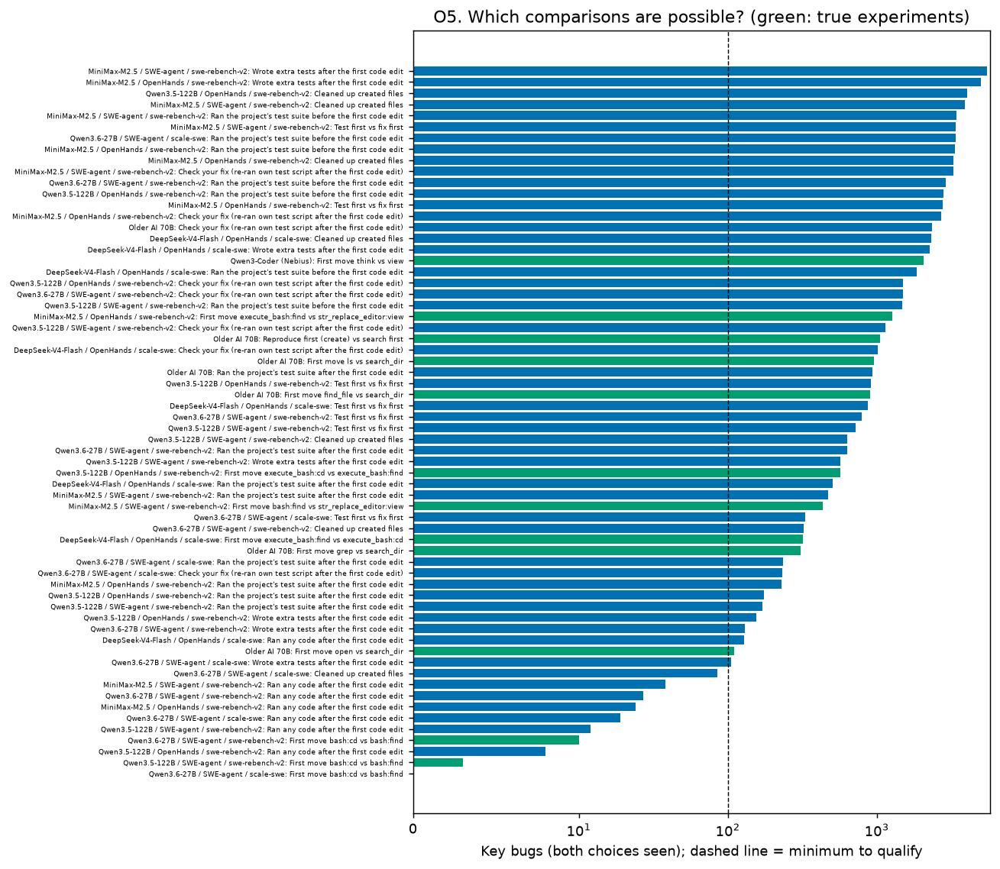

# Step 4: Exploratory Data Analysis

*Generated by `agent-tips onetry eda`. Paper 2, the one-try study. Counts and descriptions only: no correction method is run in this step.*

## In plain words

- **Bug or luck?** Which bug it is explains 51%–87% of whether a try fixes it; the rest is luck between tries. This is why one-try studies can be fooled by easy bugs.
- **Do AIs agree on which bugs are hard?** Among NVIDIA setups, strongly (median correlation 0.73). Between the 2024 older AI and the 2026 Nebius AI, weakly (0.28). So other AIs' results should help most for the NVIDIA setups.
- **Does the bug report hint at difficulty?** Somewhat: the largest gap is 13 points (long_report in `newer_ai_nvidia`: 36% fixed with it vs 49% without). So a model that reads the report has something to work with; how much it actually removes the easy-bug effect is tested in Step 6.
- **What can we test?** 54 comparisons qualify (at least 100 bugs with both choices): 10 true experiments (first moves) and 44 mid-run choices. This list is now fixed for modelling.

## O1. Fix rates by AI setup

## O2. Bug or luck?

| AI setup | Explained by the bug | Bugs with mixed outcomes | Bugs with ≥2 tries |
| --- | --- | --- | --- |
| Qwen3-Coder (Nebius) | 80% | 28% | 6,282 |
| DeepSeek-V4-Flash / OpenHands / scale-swe | 87% | 6% | 10,688 |
| MiniMax-M2.5 / OpenHands / swe-rebench-v2 | 81% | 12% | 11,604 |
| Qwen3.5-122B / OpenHands / swe-rebench-v2 | 71% | 16% | 10,802 |
| Older AI 70B | 51% | 22% | 3,580 |
| MiniMax-M2.5 / SWE-agent / swe-rebench-v2 | 78% | 15% | 12,405 |
| Qwen3.5-122B / SWE-agent / swe-rebench-v2 | 77% | 15% | 4,677 |
| Qwen3.6-27B / SWE-agent / scale-swe | 86% | 9% | 12,662 |
| Qwen3.6-27B / SWE-agent / swe-rebench-v2 | 80% | 12% | 11,512 |

## O3. Do different AIs find the same bugs hard?

| Setup A | Setup B | Shared bugs | Correlation |
| --- | --- | --- | --- |
| DeepSeek-V4-Flash / OpenHands / scale-swe | Qwen3.6-27B / SWE-agent / scale-swe | 13,987 | 0.81 |
| MiniMax-M2.5 / OpenHands / swe-rebench-v2 | MiniMax-M2.5 / SWE-agent / swe-rebench-v2 | 13,373 | 0.78 |
| Qwen3.5-122B / OpenHands / swe-rebench-v2 | MiniMax-M2.5 / SWE-agent / swe-rebench-v2 | 12,658 | 0.64 |
| MiniMax-M2.5 / OpenHands / swe-rebench-v2 | Qwen3.5-122B / OpenHands / swe-rebench-v2 | 12,636 | 0.73 |
| MiniMax-M2.5 / SWE-agent / swe-rebench-v2 | Qwen3.6-27B / SWE-agent / swe-rebench-v2 | 11,812 | 0.75 |
| MiniMax-M2.5 / OpenHands / swe-rebench-v2 | Qwen3.6-27B / SWE-agent / swe-rebench-v2 | 11,494 | 0.68 |
| Qwen3.5-122B / OpenHands / swe-rebench-v2 | Qwen3.6-27B / SWE-agent / swe-rebench-v2 | 11,059 | 0.64 |
| MiniMax-M2.5 / SWE-agent / swe-rebench-v2 | Qwen3.5-122B / SWE-agent / swe-rebench-v2 | 7,231 | 0.76 |
| Qwen3.5-122B / OpenHands / swe-rebench-v2 | Qwen3.5-122B / SWE-agent / swe-rebench-v2 | 7,102 | 0.66 |
| MiniMax-M2.5 / OpenHands / swe-rebench-v2 | Qwen3.5-122B / SWE-agent / swe-rebench-v2 | 7,012 | 0.69 |
| Qwen3.5-122B / SWE-agent / swe-rebench-v2 | Qwen3.6-27B / SWE-agent / swe-rebench-v2 | 6,623 | 0.75 |
| Qwen3-Coder (Nebius) | Older AI 70B | 1,203 | 0.28 |
| Older AI 70B | Older AI 8B | 528 | 0.82 |
| Qwen3-Coder (Nebius) | Older AI 8B | 221 | 0.29 |

## Does the bug report hint at difficulty?

| Dataset | Report fact | Bugs with it | Fix rate with | Fix rate without |
| --- | --- | --- | --- | --- |
| `newer_ai_nebius` | has_code_block | 60% | 51% | 43% |
| `newer_ai_nebius` | has_stack_trace | 15% | 53% | 47% |
| `newer_ai_nebius` | names_file | 36% | 52% | 45% |
| `newer_ai_nebius` | long_report | 50% | 47% | 49% |
| `newer_ai_nvidia` | has_code_block | 48% | 43% | 42% |
| `newer_ai_nvidia` | has_stack_trace | 4% | 44% | 42% |
| `newer_ai_nvidia` | names_file | 43% | 36% | 48% |
| `newer_ai_nvidia` | long_report | 50% | 36% | 49% |
| `older_ai` | has_code_block | 58% | 11% | 8% |
| `older_ai` | has_stack_trace | 14% | 16% | 9% |
| `older_ai` | names_file | 35% | 15% | 7% |
| `older_ai` | long_report | 50% | 11% | 9% |

## O4. Length of tries

Flagged as outliers (zero actions or above the 99.9th percentile): 281 tries. They are kept: an unusually long try is still a real try.

## O5. Comparison inventory

*Key bugs: bugs where both choices occur. Other-AI columns describe those key bugs: the share with at least one other setup's result, the mean number of other setups, and how well this setup's per-bug fix rate agrees with the other setups' (descriptive only).*

| Qualifies | Kind | AI setup | Behaviour (a vs b) | Key bugs | Tries a / b | Share a | With other AIs | Other setups (mean) | Agreement |
| --- | --- | --- | --- | --- | --- | --- | --- | --- | --- |
| yes | true experiment | Qwen3-Coder (Nebius) | First move think vs view | 2,067 | 54,024 / 13,019 | 81% | 21% | 0.3 | 0.21 |
| yes | true experiment | MiniMax-M2.5 / OpenHands / swe-rebench-v2 | First move execute_bash:find vs str_replace_editor:view | 1,276 | 1,765 / 32,094 | 5% | 99% | 3.2 | 0.87 |
| yes | true experiment | Older AI 70B | Reproduce first (create) vs search first | 1,048 | 29,888 / 30,097 | 50% | 48% | 0.7 | 0.39 |
| yes | true experiment | Older AI 70B | First move ls vs search_dir | 963 | 6,157 / 13,570 | 31% | 48% | 0.6 | 0.45 |
| yes | true experiment | Older AI 70B | First move find_file vs search_dir | 905 | 9,629 / 13,570 | 42% | 48% | 0.6 | 0.45 |
| yes | true experiment | Qwen3.5-122B / OpenHands / swe-rebench-v2 | First move execute_bash:cd vs execute_bash:find | 567 | 1,013 / 29,930 | 3% | 99% | 3.1 | 0.73 |
| yes | true experiment | MiniMax-M2.5 / SWE-agent / swe-rebench-v2 | First move bash:find vs str_replace_editor:view | 433 | 687 / 35,237 | 2% | 99% | 3.4 | 0.90 |
| yes | true experiment | DeepSeek-V4-Flash / OpenHands / scale-swe | First move execute_bash:find vs execute_bash:cd | 318 | 419 / 26,013 | 2% | 88% | 0.9 | 0.85 |
| yes | true experiment | Older AI 70B | First move grep vs search_dir | 307 | 571 / 13,570 | 4% | 57% | 0.7 | 0.34 |
| yes | true experiment | Older AI 70B | First move open vs search_dir | 111 | 1,420 / 13,570 | 9% | 58% | 0.8 | 0.48 |
| yes | mid-run | MiniMax-M2.5 / SWE-agent / swe-rebench-v2 | Wrote extra tests after the first code edit | 5,514 | 16,564 / 17,998 | 48% | 99% | 3.2 | 0.83 |
| yes | mid-run | MiniMax-M2.5 / OpenHands / swe-rebench-v2 | Wrote extra tests after the first code edit | 4,999 | 14,811 / 18,096 | 45% | 100% | 3.2 | 0.82 |
| yes | mid-run | Qwen3.5-122B / OpenHands / swe-rebench-v2 | Cleaned up created files | 4,032 | 22,003 / 8,057 | 73% | 99% | 3.3 | 0.75 |
| yes | mid-run | MiniMax-M2.5 / SWE-agent / swe-rebench-v2 | Cleaned up created files | 3,899 | 24,166 / 10,396 | 70% | 99% | 3.1 | 0.84 |
| yes | mid-run | MiniMax-M2.5 / SWE-agent / swe-rebench-v2 | Ran the project's test suite before the first code edit | 3,440 | 18,709 / 15,853 | 54% | 99% | 3.2 | 0.83 |
| yes | mid-run | MiniMax-M2.5 / SWE-agent / swe-rebench-v2 | Test first vs fix first | 3,382 | 18,598 / 15,964 | 54% | 99% | 3.2 | 0.84 |
| yes | mid-run | Qwen3.6-27B / SWE-agent / scale-swe | Ran the project's test suite before the first code edit | 3,367 | 10,841 / 24,851 | 30% | 94% | 0.9 | 0.82 |
| yes | mid-run | MiniMax-M2.5 / OpenHands / swe-rebench-v2 | Ran the project's test suite before the first code edit | 3,353 | 12,718 / 20,189 | 39% | 99% | 3.1 | 0.82 |
| yes | mid-run | MiniMax-M2.5 / OpenHands / swe-rebench-v2 | Cleaned up created files | 3,281 | 23,850 / 9,057 | 72% | 99% | 3.1 | 0.83 |
| yes | mid-run | MiniMax-M2.5 / SWE-agent / swe-rebench-v2 | Check your fix (re-ran own test script after the first code edit) | 3,264 | 11,069 / 23,493 | 32% | 99% | 3.2 | 0.84 |
| yes | mid-run | Qwen3.6-27B / SWE-agent / swe-rebench-v2 | Ran the project's test suite before the first code edit | 2,888 | 15,102 / 17,760 | 46% | 77% | 2.6 | 0.81 |
| yes | mid-run | Qwen3.5-122B / OpenHands / swe-rebench-v2 | Ran the project's test suite before the first code edit | 2,807 | 10,072 / 19,988 | 34% | 99% | 3.2 | 0.70 |
| yes | mid-run | MiniMax-M2.5 / OpenHands / swe-rebench-v2 | Test first vs fix first | 2,765 | 17,751 / 15,156 | 54% | 99% | 3.1 | 0.82 |
| yes | mid-run | MiniMax-M2.5 / OpenHands / swe-rebench-v2 | Check your fix (re-ran own test script after the first code edit) | 2,710 | 12,746 / 20,161 | 39% | 99% | 3.1 | 0.82 |
| yes | mid-run | Older AI 70B | Check your fix (re-ran own test script after the first code edit) | 2,346 | 31,384 / 24,162 | 57% | 49% | 0.7 | 0.41 |
| yes | mid-run | DeepSeek-V4-Flash / OpenHands / scale-swe | Cleaned up created files | 2,324 | 6,593 / 19,522 | 25% | 88% | 0.9 | 0.82 |
| yes | mid-run | DeepSeek-V4-Flash / OpenHands / scale-swe | Wrote extra tests after the first code edit | 2,279 | 7,541 / 18,574 | 29% | 89% | 0.9 | 0.81 |
| yes | mid-run | DeepSeek-V4-Flash / OpenHands / scale-swe | Ran the project's test suite before the first code edit | 1,854 | 4,452 / 21,663 | 17% | 85% | 0.9 | 0.80 |
| yes | mid-run | Qwen3.5-122B / OpenHands / swe-rebench-v2 | Check your fix (re-ran own test script after the first code edit) | 1,508 | 18,457 / 11,603 | 61% | 99% | 3.2 | 0.65 |
| yes | mid-run | Qwen3.6-27B / SWE-agent / swe-rebench-v2 | Check your fix (re-ran own test script after the first code edit) | 1,503 | 21,719 / 11,143 | 66% | 74% | 2.4 | 0.77 |
| yes | mid-run | Qwen3.5-122B / SWE-agent / swe-rebench-v2 | Ran the project's test suite before the first code edit | 1,486 | 4,463 / 10,431 | 30% | 100% | 3.7 | 0.83 |
| yes | mid-run | Qwen3.5-122B / SWE-agent / swe-rebench-v2 | Check your fix (re-ran own test script after the first code edit) | 1,145 | 8,390 / 6,504 | 56% | 100% | 3.6 | 0.82 |
| yes | mid-run | DeepSeek-V4-Flash / OpenHands / scale-swe | Check your fix (re-ran own test script after the first code edit) | 1,011 | 2,166 / 23,949 | 8% | 89% | 0.9 | 0.84 |
| yes | mid-run | Older AI 70B | Ran the project's test suite after the first code edit | 937 | 2,603 / 52,943 | 5% | 50% | 0.7 | 0.44 |
| yes | mid-run | Qwen3.5-122B / OpenHands / swe-rebench-v2 | Test first vs fix first | 909 | 27,701 / 2,359 | 92% | 99% | 2.9 | 0.71 |
| yes | mid-run | DeepSeek-V4-Flash / OpenHands / scale-swe | Test first vs fix first | 874 | 2,625 / 23,490 | 10% | 89% | 0.9 | 0.83 |
| yes | mid-run | Qwen3.6-27B / SWE-agent / swe-rebench-v2 | Test first vs fix first | 797 | 30,505 / 2,357 | 93% | 68% | 2.1 | 0.78 |
| yes | mid-run | Qwen3.5-122B / SWE-agent / swe-rebench-v2 | Test first vs fix first | 719 | 12,618 / 2,276 | 85% | 100% | 3.6 | 0.83 |
| yes | mid-run | Qwen3.5-122B / SWE-agent / swe-rebench-v2 | Cleaned up created files | 634 | 13,711 / 1,183 | 92% | 100% | 3.5 | 0.84 |
| yes | mid-run | Qwen3.6-27B / SWE-agent / swe-rebench-v2 | Ran the project's test suite after the first code edit | 631 | 31,070 / 1,792 | 95% | 55% | 1.8 | 0.76 |
| yes | mid-run | Qwen3.5-122B / SWE-agent / swe-rebench-v2 | Wrote extra tests after the first code edit | 572 | 13,864 / 1,030 | 93% | 100% | 3.8 | 0.87 |
| yes | mid-run | DeepSeek-V4-Flash / OpenHands / scale-swe | Ran the project's test suite after the first code edit | 507 | 23,696 / 2,419 | 91% | 85% | 0.8 | 0.81 |
| yes | mid-run | MiniMax-M2.5 / SWE-agent / swe-rebench-v2 | Ran the project's test suite after the first code edit | 474 | 33,349 / 1,213 | 96% | 99% | 3.2 | 0.77 |
| yes | mid-run | Qwen3.6-27B / SWE-agent / scale-swe | Test first vs fix first | 330 | 35,026 / 666 | 98% | 93% | 0.9 | 0.74 |
| yes | mid-run | Qwen3.6-27B / SWE-agent / swe-rebench-v2 | Cleaned up created files | 322 | 32,377 / 485 | 99% | 69% | 2.2 | 0.84 |
| yes | mid-run | Qwen3.6-27B / SWE-agent / scale-swe | Ran the project's test suite after the first code edit | 235 | 33,859 / 1,833 | 95% | 92% | 0.9 | 0.73 |
| yes | mid-run | Qwen3.6-27B / SWE-agent / scale-swe | Check your fix (re-ran own test script after the first code edit) | 231 | 35,279 / 413 | 99% | 89% | 0.9 | 0.81 |
| yes | mid-run | MiniMax-M2.5 / OpenHands / swe-rebench-v2 | Ran the project's test suite after the first code edit | 230 | 32,210 / 697 | 98% | 100% | 3.2 | 0.71 |
| yes | mid-run | Qwen3.5-122B / OpenHands / swe-rebench-v2 | Ran the project's test suite after the first code edit | 174 | 29,656 / 404 | 99% | 99% | 3.2 | 0.77 |
| yes | mid-run | Qwen3.5-122B / SWE-agent / swe-rebench-v2 | Ran the project's test suite after the first code edit | 171 | 14,436 / 458 | 97% | 100% | 3.6 | 0.77 |
| yes | mid-run | Qwen3.5-122B / OpenHands / swe-rebench-v2 | Wrote extra tests after the first code edit | 156 | 29,855 / 205 | 99% | 99% | 3.2 | 0.45 |
| yes | mid-run | Qwen3.6-27B / SWE-agent / swe-rebench-v2 | Wrote extra tests after the first code edit | 130 | 32,666 / 196 | 99% | 77% | 2.5 | 0.81 |
| yes | mid-run | DeepSeek-V4-Flash / OpenHands / scale-swe | Ran any code after the first code edit | 129 | 25,733 / 382 | 99% | 95% | 0.9 | 0.90 |
| yes | mid-run | Qwen3.6-27B / SWE-agent / scale-swe | Wrote extra tests after the first code edit | 105 | 35,557 / 135 | 100% | 87% | 0.9 | 0.86 |
| no | true experiment | Qwen3.6-27B / SWE-agent / swe-rebench-v2 | First move bash:cd vs bash:find | 10 | 57 / 33,618 | 0% | 90% | 3.3 | — |
| no | true experiment | Qwen3.5-122B / SWE-agent / swe-rebench-v2 | First move bash:cd vs bash:find | 3 | 3 / 15,095 | 0% | 100% | 3.3 | — |
| no | true experiment | Qwen3.6-27B / SWE-agent / scale-swe | First move bash:cd vs bash:find | 0 | 3 / 36,200 | 0% | 0% | 0.0 | — |
| no | mid-run | Qwen3.6-27B / SWE-agent / scale-swe | Cleaned up created files | 85 | 35,589 / 103 | 100% | 85% | 0.8 | 0.75 |
| no | mid-run | MiniMax-M2.5 / SWE-agent / swe-rebench-v2 | Ran any code after the first code edit | 38 | 34,456 / 106 | 100% | 100% | 3.1 | 0.58 |
| no | mid-run | Qwen3.6-27B / SWE-agent / swe-rebench-v2 | Ran any code after the first code edit | 27 | 32,804 / 58 | 100% | 44% | 1.1 | — |
| no | mid-run | MiniMax-M2.5 / OpenHands / swe-rebench-v2 | Ran any code after the first code edit | 24 | 32,842 / 65 | 100% | 100% | 3.0 | — |
| no | mid-run | Qwen3.6-27B / SWE-agent / scale-swe | Ran any code after the first code edit | 19 | 35,664 / 28 | 100% | 84% | 0.8 | — |
| no | mid-run | Qwen3.5-122B / SWE-agent / swe-rebench-v2 | Ran any code after the first code edit | 12 | 14,870 / 24 | 100% | 100% | 3.7 | — |
| no | mid-run | Qwen3.5-122B / OpenHands / swe-rebench-v2 | Ran any code after the first code edit | 8 | 30,048 / 12 | 100% | 88% | 2.5 | — |

## Notes for the next steps

- The qualifying comparisons above are the fixed list for Step 6. Comparisons that do not qualify are not used.
- "Check your fix" and the other after-fix choices only count tries that edited code (as in Paper 1).
- The older AI's comparisons use dated tries in bug × day groups for the answer key; its one-try copies ignore the day, as a one-try researcher would.
