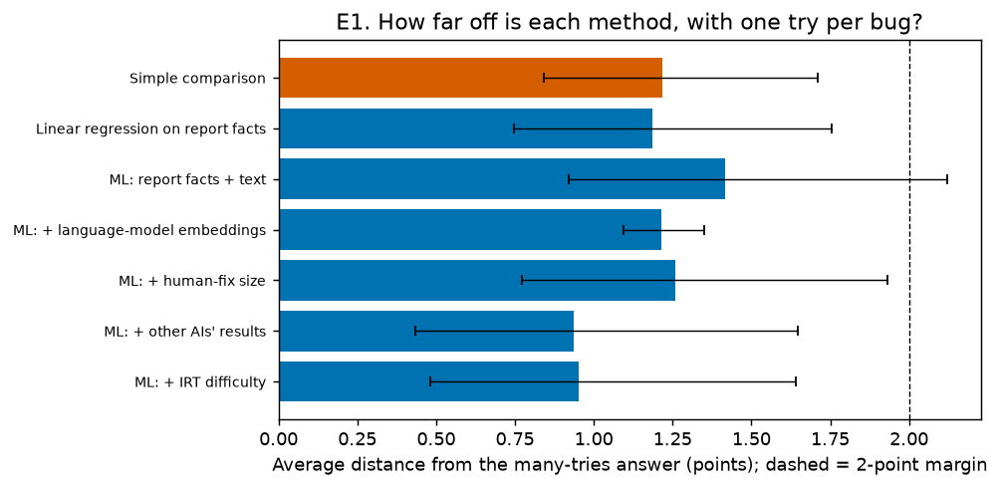
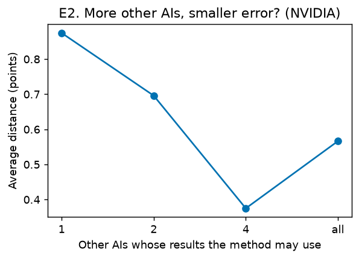
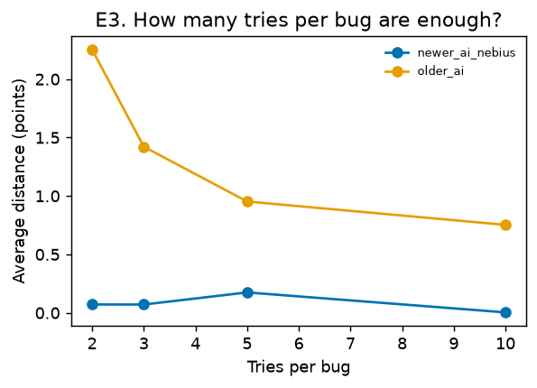

# Step 7: Evaluation

*Generated by `agent-tips onetry evaluate`. Paper 2, the one-try study. Rules frozen in `01_problem.md` (tag `one-try-plan-v1`, amendments A1–A9).*

## In plain words

- **How wrong is a one-try study?** The simple comparison is off by 1.2 points on average (H1: not supported).
- **Does machine learning on the bug report fix it?** Not enough: linear regression is off by 1.2 and ML on report facts + text by 1.4 points (H2: not supported).
- **Does adding other AIs' results fix it?** Rung 5 is off by 0.9 points on average; the upper bound is 1.5 against the 2-point margin (H3: supported).
- **When does it fail?** H4: not supported (gain vs agreement slope +0.6 points per unit; error vs number of other AIs ρ = -0.19).
- **Realistic one-try studies (all bugs, amendment A7):** simple comparison off by 9.0, report-text ML 5.0, other-AI ML 1.7 points.
- **Reproducible:** re-running the sampled comparisons gave identical results.

## Hypotheses

| Hypothesis | Rule | Result | Holm p | Decision |
| --- | --- | --- | --- | --- |
| H1: simple comparison is off by more than 2 points | lower 95% bound > 2 | 1.2 (bound 0.9) | 1.000 | not supported |
| H2: report-only corrections stay off by more than 2 | both lower bounds > 2 | rung 1 1.2 (bound 0.8); rung 2 1.4 (bound 1.0) | 1.000 | not supported |
| H3: other-AI correction is within 2 | upper 95% bound < 2 | 0.9 (bound 1.5) | 0.016 | supported |
| H4: the gain shrinks when other-AI information is weaker | slope > 0 and ρ < 0, both one-sided | slope +0.6 (p 0.085); ρ -0.19 (p 0.005) | 0.254 | not supported |

## All methods

*Average absolute distance from the many-tries answer over comparisons (points), 95% bounds from bootstrap resamples of AI setups; coverage = share of draws whose 95% interval contains the answer; conclusion = share of draws that reach the same conclusion (helps / hurts / no clear difference).*

| Method | Comparisons | Average distance | 95% bounds | Median | Coverage | Same conclusion | Same direction |
| --- | --- | --- | --- | --- | --- | --- | --- |
| Simple comparison | 54 | 1.2 | 0.8–1.7 | 1.0 | 93% | 89% | 97% |
| Linear regression on report facts | 54 | 1.2 | 0.7–1.8 | 0.9 | 93% | 89% | 96% |
| ML: report facts + text | 54 | 1.4 | 0.9–2.1 | 1.0 | 88% | 84% | 90% |
| ML: + human-fix size | 54 | 1.3 | 0.8–1.9 | 0.8 | 89% | 84% | 92% |
| ML: + other AIs' results | 54 | 0.9 | 0.4–1.6 | 0.5 | 91% | 87% | 94% |
| ML: + IRT difficulty | 54 | 1.0 | 0.5–1.6 | 0.5 | 92% | 87% | 92% |
| ML: + language-model embeddings | 54 | 1.2 | 1.1–1.4 | 1.1 | 94% | 90% | 96% |
| ML: + other AIs, one try each (realistic) | 54 | 1.0 | 0.5–1.6 | 0.5 | 92% | 88% | 94% |
| ML: + the AI's own other tries (oracle) | 8 | 1.4 | 0.4–1.6 | 1.0 | 81% | 74% | 85% |

## By dataset and by kind of comparison

| Group | Simple comparison | Linear regression on report facts | ML: report facts + text | ML: + human-fix size | ML: + other AIs' results | ML: + IRT difficulty |
| --- | --- | --- | --- | --- | --- | --- |
| newer_ai_nebius | 1.2 | 2.4 | 1.9 | 1.9 | 1.7 | 1.8 |
| newer_ai_nvidia | 1.0 | 0.9 | 1.1 | 0.9 | 0.6 | 0.6 |
| older_ai | 2.7 | 2.9 | 3.6 | 3.4 | 3.2 | 3.2 |
| mid-run | 1.1 | 1.0 | 1.2 | 1.0 | 0.7 | 0.7 |
| true experiment | 1.7 | 1.9 | 2.2 | 2.2 | 2.1 | 2.1 |

## Checks (draws 0–4; not used for decisions)

| Check | Average distance (points) | Same draws, main method |
| --- | --- | --- |
| rung5_forest | 1.3 | 1.2 |
| rung5_real | 1.2 | 1.2 |
| rung7 | 1.9 | 2.7 |
| rung2_aipw | 6.0 | 1.7 |
| rung4_aipw | 5.9 | 1.5 |
| rung5_aipw | 4.9 | 1.2 |
| rung3 | 1.2 | 1.7 |

## Secondary: copies drawn from all bugs (amendment A7, draws 0–4)

*A real one-try study cannot leave out bugs where the AI always or never makes a choice; these copies keep them. The answer key covers key bugs only, so part of the difference can come from the two groups of bugs having different true effects.*

| Method | Key bugs only | All bugs |
| --- | --- | --- |
| Simple comparison | 1.6 | 9.0 |
| Linear regression on report facts | 1.5 | 6.3 |
| ML: report facts + text | 1.7 | 5.0 |
| ML: + other AIs' results | 1.2 | 1.7 |
| rung0_allbugs_trim | 1.6 | 6.7 |
| rung1_allbugs_trim | 1.5 | 7.3 |
| rung5_aipw_allbugs | 4.9 | 2.5 |
| rung5_aipw_allbugs_trim | 4.9 | 2.8 |

## H4b: rung 5 with fewer other AIs (NVIDIA)

| Other AIs used | Average distance (points) |
| --- | --- |
| 1 | 0.9 |
| 2 | 0.7 |
| 4 | 0.4 |
| all | 0.6 |

## RQ4: how many tries per bug are enough?

| Dataset | Tries per bug | Average distance (points) | Comparisons |
| --- | --- | --- | --- |
| `newer_ai_nebius` | 2 | 0.1 | 1 |
| `newer_ai_nebius` | 3 | 0.1 | 1 |
| `newer_ai_nebius` | 5 | 0.2 | 1 |
| `newer_ai_nebius` | 10 | 0.0 | 1 |
| `older_ai` | 2 | 2.3 | 7 |
| `older_ai` | 3 | 1.4 | 7 |
| `older_ai` | 5 | 1.0 | 7 |
| `older_ai` | 10 | 0.8 | 7 |

## Precision check (amendment A4)

Average distance with 20 vs 40 draws: simple comparison 1.2 vs 1.3; rung 5 0.9 vs 0.8. The rule is a difference below 0.2 points: passed, 20 draws are enough.

## Reproducibility (amendment A3)

| Comparison re-run in full | Identical |
| --- | --- |
| `openhands/qwen35_122b/swe-rebench-v2|tests_after_fix` | yes |
| `sweagent/minimax_m25/swe-rebench-v2|suite_after_fix` | yes |
| `sweagent/qwen36_27b/scale-swe|rerun_after_fix` | yes |

## Per comparison

| Comparison | Kind | Key bugs | Noise floor | Rung 0 | Rung 1 | Rung 2 | Rung 4 | Rung 5 | Rung 6 |
| --- | --- | --- | --- | --- | --- | --- | --- | --- | --- |
| `sweagent/minimax_m25/swe-rebench-v2|tests_after_fix` | mid-run | 5,514 | 0.8 | -0.1 | +0.2 | +0.0 | +0.3 | -0.0 | +0.0 |
| `openhands/minimax_m25/swe-rebench-v2|tests_after_fix` | mid-run | 4,999 | 0.8 | +0.1 | +0.7 | +0.4 | +0.3 | +0.3 | +0.3 |
| `openhands/qwen35_122b/swe-rebench-v2|cleanup` | mid-run | 4,032 | 1.0 | -0.1 | +0.3 | -0.1 | -0.3 | -0.5 | -0.3 |
| `sweagent/minimax_m25/swe-rebench-v2|cleanup` | mid-run | 3,899 | 0.9 | +1.9 | +1.8 | +1.7 | +1.1 | +0.1 | +0.1 |
| `sweagent/minimax_m25/swe-rebench-v2|suite_before_fix` | mid-run | 3,440 | 1.0 | -0.2 | +0.0 | -0.1 | -0.2 | -0.4 | -0.3 |
| `sweagent/minimax_m25/swe-rebench-v2|test_first` | mid-run | 3,382 | 1.0 | +1.9 | +2.0 | +1.8 | +1.0 | +0.6 | +0.7 |
| `sweagent/qwen36_27b/scale-swe|suite_before_fix` | mid-run | 3,367 | 0.8 | -1.1 | -0.9 | -1.0 | -1.1 | -0.7 | -0.7 |
| `openhands/minimax_m25/swe-rebench-v2|suite_before_fix` | mid-run | 3,353 | 0.9 | -0.3 | -0.1 | -0.2 | -0.3 | -0.0 | -0.0 |
| `openhands/minimax_m25/swe-rebench-v2|cleanup` | mid-run | 3,281 | 0.9 | +2.1 | +2.0 | +1.5 | +0.8 | +0.2 | +0.1 |
| `sweagent/minimax_m25/swe-rebench-v2|rerun_after_fix` | mid-run | 3,264 | 1.0 | -0.0 | -0.4 | +0.0 | -0.3 | -0.3 | -0.4 |
| `sweagent/qwen36_27b/swe-rebench-v2|suite_before_fix` | mid-run | 2,888 | 1.1 | -0.5 | -0.3 | -0.4 | -0.5 | +0.4 | +0.4 |
| `openhands/qwen35_122b/swe-rebench-v2|suite_before_fix` | mid-run | 2,807 | 1.2 | -1.1 | -0.9 | -0.6 | -0.2 | -0.1 | -0.3 |
| `openhands/minimax_m25/swe-rebench-v2|test_first` | mid-run | 2,765 | 1.0 | +1.1 | +1.1 | +1.4 | +0.9 | +0.1 | +0.2 |
| `openhands/minimax_m25/swe-rebench-v2|rerun_after_fix` | mid-run | 2,710 | 0.9 | +1.7 | +1.4 | +1.5 | +0.8 | +0.1 | +0.0 |
| `older_ai|rerun_after_fix` | mid-run | 2,346 | 0.9 | +1.9 | +1.6 | +1.1 | +1.0 | +0.5 | +0.5 |
| `openhands/deepseek_v4_flash_0731/scale-swe|cleanup` | mid-run | 2,324 | 1.1 | +0.1 | -0.1 | +0.1 | +0.0 | -0.1 | +0.0 |
| `openhands/deepseek_v4_flash_0731/scale-swe|tests_after_fix` | mid-run | 2,279 | 1.1 | +0.1 | +0.1 | +0.0 | -0.2 | -0.5 | -0.5 |
| `newer_ai_nebius|think_first` | true experiment | 2,067 | 0.7 | +1.2 | +2.4 | +1.9 | +1.9 | +1.7 | +1.8 |
| `openhands/deepseek_v4_flash_0731/scale-swe|suite_before_fix` | mid-run | 1,854 | 1.2 | +0.1 | +0.0 | -0.1 | -0.2 | -0.0 | +0.2 |
| `openhands/qwen35_122b/swe-rebench-v2|rerun_after_fix` | mid-run | 1,508 | 1.8 | +0.9 | +0.9 | +0.2 | +0.1 | -0.8 | -0.3 |
| `sweagent/qwen36_27b/swe-rebench-v2|rerun_after_fix` | mid-run | 1,503 | 1.7 | +1.2 | +0.9 | +0.8 | +0.7 | +0.6 | +0.5 |
| `sweagent/qwen35_122b/swe-rebench-v2|suite_before_fix` | mid-run | 1,486 | 1.6 | -1.0 | -0.5 | -0.7 | -0.4 | -0.2 | -0.4 |
| `openhands/minimax_m25/swe-rebench-v2|first_move` | true experiment | 1,276 | 1.4 | +0.6 | +0.2 | +0.3 | +0.1 | +0.0 | +0.0 |
| `sweagent/qwen35_122b/swe-rebench-v2|rerun_after_fix` | mid-run | 1,145 | 1.8 | +1.9 | +1.7 | +1.9 | +1.5 | +0.8 | +0.9 |
| `older_ai|reproduce_first` | true experiment | 1,048 | 1.3 | +0.6 | +0.7 | +3.0 | +2.5 | +2.2 | +2.3 |
| `openhands/deepseek_v4_flash_0731/scale-swe|rerun_after_fix` | mid-run | 1,011 | 1.5 | +0.3 | +0.2 | +0.5 | +0.5 | +0.1 | +0.1 |
| `older_ai|first_ls` | true experiment | 963 | 1.2 | -2.5 | -2.7 | +0.7 | +1.1 | +0.5 | +0.9 |
| `older_ai|suite_after_fix` | mid-run | 937 | 1.6 | -5.1 | -4.7 | +6.3 | +5.3 | +4.5 | +4.3 |
| `openhands/qwen35_122b/swe-rebench-v2|test_first` | mid-run | 909 | 2.0 | +0.4 | +0.2 | -1.3 | -1.6 | -0.9 | -1.1 |
| `older_ai|first_find_file` | true experiment | 905 | 1.5 | -1.4 | -2.4 | +1.5 | +1.3 | +1.3 | +1.2 |
| `openhands/deepseek_v4_flash_0731/scale-swe|test_first` | mid-run | 874 | 1.6 | -1.2 | -0.9 | -0.6 | -0.6 | -0.3 | -0.2 |
| `sweagent/qwen36_27b/swe-rebench-v2|test_first` | mid-run | 797 | 1.9 | -0.3 | -0.7 | -1.8 | -2.2 | -0.7 | -0.8 |
| `sweagent/qwen35_122b/swe-rebench-v2|test_first` | mid-run | 719 | 2.2 | +2.6 | +1.3 | +0.6 | -0.3 | -0.5 | -0.5 |
| `sweagent/qwen35_122b/swe-rebench-v2|cleanup` | mid-run | 634 | 2.7 | -0.8 | -0.8 | -4.4 | -3.2 | -1.7 | -1.8 |
| `sweagent/qwen36_27b/swe-rebench-v2|suite_after_fix` | mid-run | 631 | 2.2 | +1.4 | +1.4 | -2.2 | -2.6 | -1.3 | -1.6 |
| `sweagent/qwen35_122b/swe-rebench-v2|tests_after_fix` | mid-run | 572 | 2.6 | -0.6 | -0.0 | -1.3 | -0.8 | +0.2 | -0.1 |
| `openhands/qwen35_122b/swe-rebench-v2|first_move` | true experiment | 567 | 2.8 | -1.0 | -1.0 | +1.4 | +1.2 | -0.3 | +0.2 |
| `openhands/deepseek_v4_flash_0731/scale-swe|suite_after_fix` | mid-run | 507 | 2.2 | -0.8 | -0.9 | -1.2 | -0.7 | +0.1 | +0.5 |
| `sweagent/minimax_m25/swe-rebench-v2|suite_after_fix` | mid-run | 474 | 2.7 | -1.8 | -1.7 | -2.4 | -2.4 | -0.6 | -0.4 |
| `sweagent/minimax_m25/swe-rebench-v2|first_move` | true experiment | 433 | 2.6 | -2.0 | -1.0 | -0.7 | -1.5 | +0.6 | +0.7 |
| `sweagent/qwen36_27b/scale-swe|test_first` | mid-run | 330 | 3.0 | +1.9 | +1.6 | +0.6 | +0.2 | -0.7 | -0.6 |
| `sweagent/qwen36_27b/swe-rebench-v2|cleanup` | mid-run | 322 | 2.5 | -0.2 | -0.4 | -2.3 | -1.2 | +0.5 | -0.0 |
| `openhands/deepseek_v4_flash_0731/scale-swe|first_move` | true experiment | 318 | 2.5 | +0.4 | -0.1 | +0.0 | -0.0 | +0.7 | +0.9 |
| `older_ai|first_grep` | true experiment | 307 | 2.8 | -4.1 | -3.9 | +8.9 | +8.5 | +9.3 | +9.2 |
| `sweagent/qwen36_27b/scale-swe|suite_after_fix` | mid-run | 235 | 3.5 | +0.6 | +0.8 | +0.5 | +0.6 | -0.4 | -0.6 |
| `sweagent/qwen36_27b/scale-swe|rerun_after_fix` | mid-run | 231 | 3.6 | +1.8 | +1.4 | +1.6 | +0.5 | -0.7 | -0.4 |
| `openhands/minimax_m25/swe-rebench-v2|suite_after_fix` | mid-run | 230 | 3.5 | +2.7 | +2.4 | +0.9 | -0.0 | +0.0 | +0.5 |
| `openhands/qwen35_122b/swe-rebench-v2|suite_after_fix` | mid-run | 174 | 5.0 | +2.9 | +2.6 | +1.1 | -0.3 | -1.1 | -0.4 |
| `sweagent/qwen35_122b/swe-rebench-v2|suite_after_fix` | mid-run | 171 | 5.6 | +0.3 | -0.6 | -1.0 | -1.8 | -0.5 | -1.1 |
| `openhands/qwen35_122b/swe-rebench-v2|tests_after_fix` | mid-run | 156 | 4.8 | -0.7 | -1.7 | -3.8 | -3.9 | -4.0 | -3.7 |
| `sweagent/qwen36_27b/swe-rebench-v2|tests_after_fix` | mid-run | 130 | 5.7 | +0.8 | +1.6 | -0.0 | +0.1 | -0.4 | -1.6 |
| `openhands/deepseek_v4_flash_0731/scale-swe|run_after_fix` | mid-run | 129 | 5.4 | +0.9 | -0.1 | +1.8 | +2.0 | +1.4 | +2.2 |
| `older_ai|first_open` | true experiment | 111 | 5.9 | -3.3 | -4.3 | -3.9 | -3.7 | -4.2 | -3.7 |
| `sweagent/qwen36_27b/scale-swe|tests_after_fix` | mid-run | 105 | 5.4 | +0.9 | +1.6 | -2.5 | -3.2 | -1.9 | -1.1 |

## Secondary scores (amendment A8; none changes H1–H4)

### Noise-corrected bias

*Error floor = how far a perfect method would still land from the answer key by chance (joint bootstrap of bugs: the answer key and the one-try estimates are redrawn together). Bias = the error that is left once that chance part is taken out (root mean square over comparisons). Clearly off = share of comparisons whose error is more than 1.96 floors.*

| Method | Comparisons | RMS error | Median floor | Bias (noise taken out) | Clearly off |
| --- | --- | --- | --- | --- | --- |
| Simple comparison | 54 | 1.6 | 0.9 | 0.9 | 20% |
| Linear regression on report facts | 54 | 1.6 | 0.9 | 0.9 | 19% |
| ML: report facts + text | 54 | 2.1 | 0.9 | 1.7 | 24% |
| ML: + human-fix size | 54 | 2.0 | 0.9 | 1.5 | 17% |
| ML: + other AIs' results | 54 | 1.8 | 0.6 | 1.5 | 13% |
| ML: + IRT difficulty | 54 | 1.8 | 0.6 | 1.5 | 13% |
| ML: + language-model embeddings | 54 | 1.5 | 1.3 | 0.0 | 7% |
| ML: + other AIs, one try each (realistic) | 54 | 1.8 | 0.6 | 1.5 | 17% |
| ML: + the AI's own other tries (oracle) | 8 | 1.8 | 0.6 | 1.4 | 38% |
| rung2_aipw | 54 | 10.2 | 4.1 | 5.6 | 17% |
| rung4_aipw | 54 | 10.6 | 3.9 | 6.4 | 15% |
| rung5_aipw | 54 | 9.4 | 3.3 | 5.7 | 9% |

### Against the answer key that weights bugs like the method

*Partialling-out ML weights each bug by p(1 − p), AIPW weights bugs equally; the frozen answer key uses n_a·n_b/(n_a + n_b). Here each method is scored against the key with its own weights.*

| Method | Average distance, frozen key | Average distance, aligned key | Bias, aligned key |
| --- | --- | --- | --- |
| ML: report facts + text | 2.1 (RMS) | 1.4 | 1.6 |
| rung2_aipw | 10.2 (RMS) | 5.9 | 5.6 |
| ML: + language-model embeddings | 1.5 (RMS) | 1.3 | 0.0 |
| ML: + human-fix size | 2.0 (RMS) | 1.2 | 1.4 |
| rung4_aipw | 10.6 (RMS) | 5.9 | 6.4 |
| ML: + other AIs' results | 1.8 (RMS) | 0.9 | 1.3 |
| rung5_aipw | 9.4 (RMS) | 4.9 | 5.7 |
| ML: + other AIs, one try each (realistic) | 1.8 (RMS) | 0.9 | 1.3 |
| ML: + IRT difficulty | 1.8 (RMS) | 0.9 | 1.3 |
| ML: + the AI's own other tries (oracle) | 1.8 (RMS) | 0.7 | 0.5 |

### Paired contrasts

*|error A| − |error B| on the same comparisons (positive = B is closer). Intervals: per-setup t (setups − 1 degrees of freedom) and Webb wild cluster bootstrap; LOSO = range when one setup is left out. NVIDIA setups share bugs and models, so setups are not fully independent.*

| A | B | Comparisons | Mean | t interval | Wild interval | LOSO range |
| --- | --- | --- | --- | --- | --- | --- |
| Simple comparison | ML: report facts + text | 54 | -0.2 | -0.6 to 0.1 | -0.5 to 0.1 | -0.3 to -0.1 |
| ML: report facts + text | ML: + other AIs' results | 54 | 0.5 | 0.2 to 0.7 | 0.3 to 0.7 | 0.4 to 0.5 |
| Simple comparison | ML: + other AIs' results | 54 | 0.3 | -0.2 to 0.6 | -0.1 to 0.6 | 0.2 to 0.4 |
| ML: report facts + text | ML: + human-fix size | 54 | 0.2 | 0.0 to 0.3 | 0.1 to 0.3 | 0.1 to 0.2 |
| ML: + human-fix size | ML: + other AIs' results | 54 | 0.3 | 0.1 to 0.5 | 0.2 to 0.5 | 0.3 to 0.4 |
| ML: + other AIs, one try each (realistic) | ML: + other AIs' results | 54 | 0.0 | -0.1 to 0.1 | -0.0 to 0.1 | -0.0 to 0.1 |
| ML: + other AIs' results | ML: + the AI's own other tries (oracle) | 8 | 1.6 | -0.4 to 3.4 | 1.5 to 1.7 | 1.4 to 1.7 |

### Few-cluster intervals for the average distance

| Method | Mean | Setups | t interval (per-setup means) | Wild interval | LOSO range |
| --- | --- | --- | --- | --- | --- |
| Simple comparison | 1.2 | 9 | 0.7 to 1.7 | 0.8 to 1.6 | 1.0 to 1.3 |
| Linear regression on report facts | 1.2 | 9 | 0.7 to 1.9 | 0.7 to 1.6 | 0.9 to 1.3 |
| ML: report facts + text | 1.4 | 9 | 0.8 to 2.2 | 0.9 to 2.0 | 1.1 to 1.6 |
| ML: + language-model embeddings | 1.2 | 9 | 1.1 to 1.4 | 1.1 to 1.3 | 1.2 to 1.2 |
| ML: + human-fix size | 1.3 | 9 | 0.7 to 2.0 | 0.7 to 1.8 | 0.9 to 1.4 |
| ML: + other AIs' results | 0.9 | 9 | 0.3 to 1.7 | 0.4 to 1.5 | 0.6 to 1.1 |
| ML: + other AIs, one try each (realistic) | 1.0 | 9 | 0.3 to 1.7 | 0.4 to 1.5 | 0.7 to 1.1 |
| ML: + IRT difficulty | 1.0 | 9 | 0.3 to 1.7 | 0.4 to 1.5 | 0.6 to 1.1 |
| ML: + the AI's own other tries (oracle) | 1.4 | 2 | -6.5 to 8.4 | 1.1 to 1.7 | 0.4 to 1.6 |

### Interval quality

*Coverage rewards wide intervals, so we also report width, the interval score (width plus 40 × the distance by which the interval misses the answer key; lower is better), detection (answer keys with a clear direction: share of draws reaching it) and false alarms (answer keys with no clear direction: share of draws claiming one).*

| Method | Width | Interval score | Detection | False alarms |
| --- | --- | --- | --- | --- |
| Simple comparison | 13.9 | 17.3 | 61% | 8% |
| Linear regression on report facts | 14.3 | 18.0 | 65% | 9% |
| ML: report facts + text | 13.8 | 23.6 | 44% | 12% |
| rung2_aipw | 50.5 | 85.0 | 20% | 10% |
| ML: + language-model embeddings | 13.6 | 16.3 | 52% | 7% |
| ML: + human-fix size | 13.3 | 21.5 | 45% | 12% |
| rung4_aipw | 49.6 | 73.9 | 12% | 7% |
| ML: + other AIs' results | 10.0 | 15.3 | 44% | 8% |
| rung5_aipw | 41.4 | 55.1 | 28% | 5% |
| ML: + other AIs, one try each (realistic) | 10.2 | 15.4 | 52% | 8% |
| ML: + IRT difficulty | 10.0 | 15.2 | 49% | 9% |
| ML: + the AI's own other tries (oracle) | 7.9 | 14.1 | 22% | 9% |

### How well the guessers guess (model diagnostics)

*R² of the fix model; AUC of the choice model (0.5 = no better than chance); choice left over = share of the choice's variation the model could not explain (the variation the estimate is built from).*

| Method | R² (fix) | AUC (choice) | Choice left over |
| --- | --- | --- | --- |
| Linear regression on report facts | 0.078 | 0.595 | 0.96 |
| ML: report facts + text | -0.110 | 0.502 | 1.12 |
| ML: + language-model embeddings | -0.053 | 0.500 | 1.10 |
| ML: + human-fix size | -0.023 | 0.502 | 1.12 |
| ML: + other AIs' results | 0.403 | 0.502 | 1.12 |
| rung5_k1 | 0.219 | 0.501 | 1.11 |
| rung5_k2 | 0.329 | 0.500 | 1.11 |
| rung5_k4 | 0.493 | 0.503 | 1.08 |
| ML: + other AIs, one try each (realistic) | 0.377 | 0.502 | 1.12 |
| ML: + IRT difficulty | 0.402 | 0.502 | 1.12 |
| ML: + the AI's own other tries (oracle) | 0.500 | 0.539 | 1.13 |

### Sensitivity: precise answer keys only (noise floor ≤ 1.5 points, 24 comparisons)

| Method | Comparisons | Average distance | 95% bounds |
| --- | --- | --- | --- |
| Simple comparison | 24 | 0.9 | 0.5–1.2 |
| Linear regression on report facts | 24 | 0.9 | 0.5–1.4 |
| ML: report facts + text | 24 | 0.8 | 0.5–1.2 |
| ML: + human-fix size | 24 | 0.7 | 0.4–1.1 |
| ML: + other AIs' results | 24 | 0.5 | 0.2–0.8 |
| ML: + IRT difficulty | 24 | 0.5 | 0.2–0.9 |

### All-bugs copies: details

- Share of the ML weight on bugs that are **not** key bugs: rung2_allbugs 58%, rung5_allbugs 58%.
- Gradient boosting's automatic early stopping (on above 10,000 rows) was on in 600 of 810 all-bugs ML fits (NVIDIA copies).

## Amendment A9 checks

- **Sealed first run** (15 comparisons; hashes intact): rungs 0–1 identical and ML rungs within 0.3 points (largest difference 0.0): **passed**.
- **Across computers:** the whole run was on one computer.
